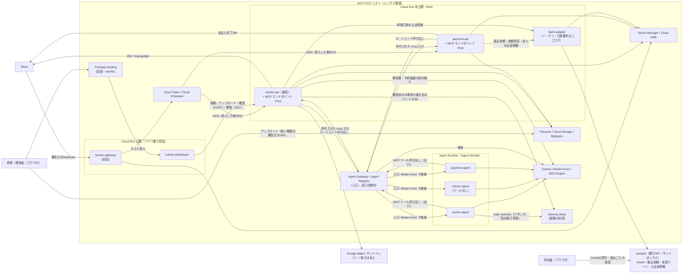
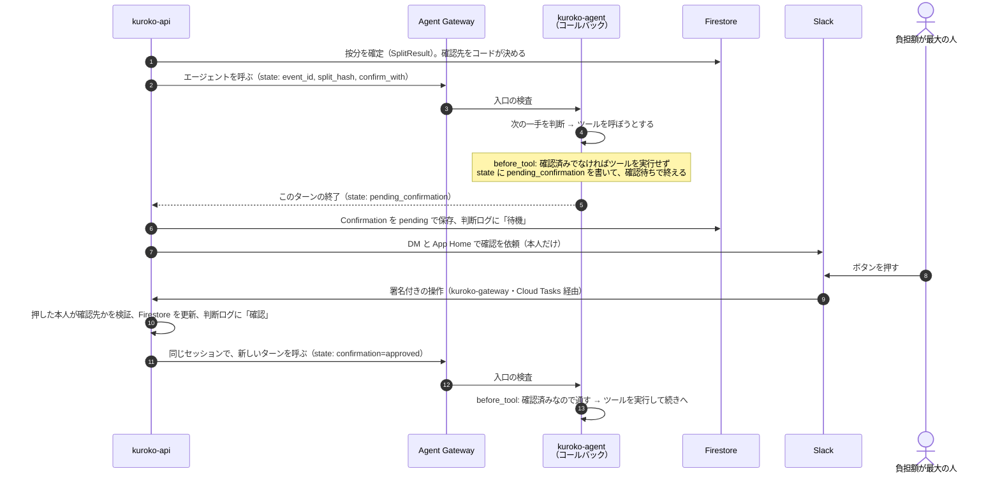

# KUROKO システム構成（ARCHITECTURE）

> エージェントへ: 本書は [SPEC.md](SPEC.md) を「実際にどのサービス・どのディレクトリ・どの権限で動かすか」に落としたもの。**機能・データモデル・ツール契約・Policy Gate・支払いフローの正は SPEC.md**で、本書はそれを繰り返さず、配置・公開範囲・権限・デプロイだけを定める。SPEC と食い違う実装が必要になったら、先に SPEC.md を直し、次に本書を直してから実装する。技術方針（シングル環境・WIFデプロイ等）は `README.md` の方針セクションと矛盾させない。

- 作成日: 2026-09-19
- 前提: [SPEC.md](SPEC.md)（正）。規程の実行時の参照は **RAG Engine**（SPEC 9.7）で、[`policies/company_rules.yaml`](../policies/company_rules.yaml) は抽出結果を検証する正解データとフォールバック
- **ADK エージェントは、基本的にすべて Google Cloud の Agent Platform の Agent Runtime（旧 Vertex AI Agent Engine）にデプロイする**（ユーザー指定）。それ以外の決定論的なコードは Cloud Run に置く
- **エージェントが呼ぶツールは MCP 経由**にする。**`kuroko-api` と `payment-api` が自分自身で MCP サーバーを兼ね、Cloud Run にデプロイする**（ユーザー指定。D11）。エージェントへの入力も、API がエージェントを呼ぶ形にして、ツールは API を MCP で呼び返させる。これで入力もツールも Agent Gateway を通る
- **インジェクション対策は Agent Gateway × Model Armor** を土台にする（ユーザー指定。D12・D13）
- **Web Dashboard は幹事の主導線**（ユーザー指定。D14・D19）。「誰が幹事か」「全体フローのどこか」「誰から誰へいくら送金されたか」「まだ承諾していない人は誰か」に加えて、**幹事の事務の確認（予約内容・領収書の金額・店舗候補の選択）を Web で行う**。委任・承認・取り消しは Slack のまま。見た目（UI デザイン）の仕様は、リポジトリ直下の [DESIGN.md](../DESIGN.md)（D15）
- **送金は、KUROKO自身が実在の銀行API（GMOあおぞらネット銀行の sunabar）を通じて実行する**（ユーザー指定。D17）。AP2 は委任・請求・領収書の署名による**権限と証跡**を担い、送金の処理は `payment-api` → `bank-adapter` → 銀行API の経路で行う。**幹事Pay など外部の集金・決済サービスは、決済手段として組み込まない**。`ap2-mock` を `bank-adapter` に置き換える
- **会社規程は Vertex AI RAG Engine で参照する**（ユーザー指定。D18）。文書の版管理はしない
- **経験の記憶は Agent Platform の Memory Bank に置く**（ユーザー指定。D20）。**統括エージェントにアタッチして読み取る**（ADK の `load_memory`。**読み取り専用のロール** `memoryViewer`。企画・店舗提案の段階だけ。`user_id` にチームのスコープIDを入れる）。**書き込みは、幹事が Web で確認した定型の事実を、`kuroko-api` のコードだけが直接書き込む**（会話からの自動生成は使わない）
- **按分の内訳を Web に出す**（ユーザー指定。D21）。`SplitResult` の値をそのまま返し、Web では再計算しない。幹事は自分のイベントだけ・開発者は仮名のみ
- **Web が主導線、Slack は Human-in-the-loop**（ユーザー指定。D22）。幹事の作業（**依頼と対話（チャット）、領収書・予約画面のアップロード**、確認、状況の把握）は Web で行う。Slack は、出欠・委任・按分の承認・銀行での承認・予算超過の最終確認・振り返りの回答（人の判断・同意）とその通知に使う。**お金の権限に触れる操作（委任・承認・取り消し・振込）は Slack だけ**
- **審査員（ゲスト）が提出した URL から触って体験できる**（ユーザー指定。D23）。ログイン不要（匿名認証）のサンドボックス。ゲストは自分の `sandbox` イベントだけ。参加者・承認者の HITL は、`sandbox` のイベントに限り、専用の実行主体 `sa-demo-runner` の**デモ用の代行**でも進められる（**要レビュー**）
- 本書で新しく決めたこと（SPEC にない決定）は **12章の D1〜D23** に集約している。合意が取れるまで「提案」として扱う。Agent Runtime・Agent Gateway・銀行API・RAG Engine・Memory Bank の挙動に依存していて、まだ確かめていないことは **13章の V1〜V14** にまとめた

### 変更履歴

| 日付 | 変更 |
|---|---|
| 2026-09-19 | 初版 |
| 2026-09-19 | エージェントを Agent Runtime にデプロイする前提に改訂。エージェント（判断と提案）と、決定論的なコード（鍵・副作用・検査）を分け、後者を Cloud Run に置く構成にした。旧 D6（Agent Runtime を使わない）を差し替え |
| 2026-09-19 | ①ツールを MCP 経由に変更。**`kuroko-api` / `payment-api` が MCP サーバーを兼ねる**（MCP Toolbox は不採用。D11）。②エージェントの入出力をすべて Agent Gateway 経由にし、Model Armor で検査（D12・D13）。自由記述も API（後段）→エージェントの経路にし、**隔離抽出をツールを持たないエージェント `extract-agent`（Agent Runtime）にした**（D16）。エージェントの実行主体を Agent identity に変更し、V1・V2 を書き直した。③Web Dashboard は幹事・開発者向けに、「幹事・全体フロー・送金・承諾」の4点に絞り、役割ごとの権限を API で強制（D14）。④DESIGN.md を UI デザインシステムとして新設（D15）。Cloud Run は5サービスのまま |
| 2026-09-20 | SPEC.md の 2026-09-20 の改訂（差別化のための3点）に追随した。①**`ap2-mock` を `bank-adapter` に置き換えた**（D17）。AP2サンプルの模擬決済役をやめ、**sunabar（GMOあおぞらネット銀行の銀行APIサンドボックス）**への窓口サービスにする。アクセストークンと口座番号を持つのはこのサービスだけ。支払いは非同期になるため、承認待ちのポーリングと期限切れの作り直しを 8章に追記（2.2・2.3・3章・4.3・4.4・5章・6章・7章・8章）。②**RAG Engine（Vertex AI）を追加**（D18）。会社規程を MCP ツール `retrieve_policy` と `extract_policy_values` から参照する（4.2・4.6・4.7・7章・11章）。③**Web Dashboard を幹事の主導線にし、書き込みのルートを追加**（D19）。幹事の事務の確認（予約内容・領収書の金額・店舗候補）を Web から行えるようにし、権限は API 側で強制する（4.5・5章・6章）。④V10（sunabar の疎通）・V11（RAG Engine）を追加 |
| 2026-09-20 | ①**ADK のコールバック関数を、フローの途中で必要になった場合に使う**ことを D6 と 4.9節に追記。例: 按分確定後に、負担額が最大の人へ確認する。コールバックは導線で、確認の依頼・検証・記録は `kuroko-api`、権威は Firestore（ADK の「ツール確認」は、Agent Runtime のセッションに非対応・実験的・偽造の問題があるため使わない）。V9 を追加。②**`DESIGN.md` はリポジトリ直下にある UI デザインの仕様**として、D15 と各リンクを直した（旧 `docs/DESIGN.md` は無い）。あわせて、D6 の理由に残っていた「隔離抽出は `kuroko-api` に置く」（D16 で `extract-agent` に変更済み）を直した |
| 2026-09-20 | SPEC.md の 2026-09-20 の改訂（2回目）に追随した。①**Memory Bank を追加**（D20）。振り返りの回答（`Feedback`）と集計（`Retrospective`）を Firestore に置き、幹事が Web で確認したものだけを `kuroko-api` のコードが Memory Bank に直接書き込む。読み取りは MCP ツール `recall_memory`（読み取り専用）。エージェントに ADK の記憶ツール・`VertexAiMemoryBankService` を持たせない。`sa-api` だけに `roles/aiplatform.memoryUser` を付ける（2.2・2.3・3章・4.2・4.5・4.6・4.7・5章・6章・7章・8章・10章・11章）。②**按分の内訳を Web に出す**（D21。4.5）。③`extract-agent` に用途（`preferences` / `feedback`）を追加し、振り返りの自由記述を語彙だけに落とす（4.2）。④V12（Memory Bank）を追加 |
| 2026-09-21 | SPEC.md の 2026-09-21 の改訂（思想の変更）に追随した。①**Web が主導線、Slack は Human-in-the-loop**（D22）。Web でチャット・アップロード・確認・通知を行い、`kuroko-dashboard` と `kuroko-api` の Web 向けの入口を拡張した（2.2・4.2・4.5・5章・6章）。②**審査員（ゲスト）が触れる導線**（D23）。匿名認証、`guest` 役割、サンドボックスのイベント、デモ用の代行（`sa-demo-runner`）、隔離とコストの上限（4.5・6章・7章・8章・10章）。③**Memory Bank を統括エージェントにアタッチして読み取る方式に変更**（D20 を書き換え）。MCP ツール `recall_memory` は廃止。`agent-kuroko` に `roles/aiplatform.memoryViewer`、`sa-api` に書き込み（`roles/aiplatform.memoryEditor`）。`load_memory` は企画・店舗提案の段階だけ（コールバック）（2.2・4.2・4.7・4.9・5章・6章・7章）。④V12 を書き換え、V13（Web のチャットの時間の上限）・V14（デモ用の代行・匿名認証）を追加 |

---

## 1. 位置づけ

| 文書 | 役割 |
|---|---|
| [SPEC.md](SPEC.md) | 何を作るか。機能、データモデル（3章）、ツール契約（4章）、Policy Gate（6章）、支払い（8章）まで含む。**旧 `DESIGN.md`（API・データモデル・エージェント設計）は SPEC.md の 3〜4章に統合済み** |
| [DESIGN.md](../DESIGN.md)（**リポジトリ直下**。`docs/` には置かない） | **UI デザインの仕様**（Web Dashboard の色・文字・余白・部品の規約）。旧 `DESIGN.md`（API・データモデル・エージェント設計。SPEC 3〜4章に統合済み）とは別物 |
| **ARCHITECTURE.md（本書）** | どう配置するか。サービス構成、コード配置、公開範囲、権限、データの置き場、デプロイ |
| [PLAN.md](PLAN.md) | 初期コンセプトと、**競合（幹事Pay）との差分**（16章。提出用の説明文の土台）。SPEC と食い違う場合は SPEC が正 |

---

## 2. 構成の全体像

### 2.1 設計の考え方

> **エージェントは判断して提案する。鍵・お金・Slackへの送信・状態の書き込みは、Cloud Run のコードだけが行う。エージェントの入出力は、必ず Agent Gateway を通る。**

- **Agent Runtime** には ADK エージェント（Gemini を呼ぶ部分）だけを置く。**ADK エージェントは例外なく Agent Runtime に置く**（今後エージェントを足す場合も同じ）。3つある: 統括の `kuroko-agent`、支払いの `payment-agent`、ツールを持たない隔離抽出の `extract-agent`（D16）。エージェントには、Gemini の呼び出しと、（あれば）自分専用の MCP エンドポイントの呼び出し以外の権限を与えない。
- **入力は「前段 → 後段 → エージェント」の順に渡す。** Slack は `kuroko-gateway`（前段。Ack だけ）→ Cloud Tasks → `kuroko-api`（後段）に届き、`kuroko-api` が**エージェントを呼ぶ**。**Web（幹事・ゲスト）は、`kuroko-dashboard`（SSR）→ `kuroko-api`（後段）に直接届く**（受け付けたらすぐに返し、処理は非同期。4.2節）。エージェントは、必要なときだけ **`kuroko-api` を MCP のツールとして呼び返す**（記憶の読み取りだけは、アタッチした `load_memory`。4.2節）。この往復がすべて Agent Gateway を通るので、入力にもツールにも Model Armor の検査が掛かる。
- **ツールは MCP**。`kuroko-api` と `payment-api` が、自分自身で MCP サーバー（`/mcp`）を兼ねて Cloud Run にデプロイされる。公開するのは SPEC 4章で「LLM可」としたツールだけ（4.7節）。
- **Agent Gateway** が、エージェントへの入力（API→エージェント）と、エージェントが外へ出す通信（エージェント→API の MCP エンドポイント）の関所になる。Model Armor で検査し、エージェントごとに呼べる MCP エンドポイントとツールを絞る（4.8節）。
- **フローの途中で必要になったときは、ADK のコールバック関数を使う**（`before/after` の agent・model・tool。D6、4.9節）。例: 按分の確定後に、負担額が最大の人へ確認を取ってから次に進める。コールバックは「確認待ちに入る導線」で、**確認の依頼・検証・記録は `kuroko-api`、確認の権威は Firestore の記録**（ADK の「ツール確認」機能は使わない）。**鍵・お金・Slackへの送信・状態の書き込みは、コールバックにも置かない。**
- **記憶（Memory Bank）は、読み取りだけをエージェントに見せる。**書き込みは、幹事の確認（Web）のあとに `kuroko-api` のコードだけが行う（Policy Gate 6.4）。記憶は店舗の提案・質問の確認・説明文にだけ使い、金額・按分・承認者・支払先・委任・規程の値には使わない（SPEC 4章冒頭）。
- **Cloud Run** には、決定論的なコード（Policy Gate、按分計算、承認者の決定、請求、委任状の署名、Slackへの送信、判断ログ）と、その MCP エンドポイントと、外部APIのキー・署名鍵を置く。
- SPEC 4章のツール表の「呼び出し元」は、次のように対応する。

| SPEC の「呼び出し元」 | 実装 |
|---|---|
| LLM可 | `kuroko-api` / `payment-api` の MCP ツール（`/mcp`）として公開する。エージェントは Agent Gateway 経由で呼ぶ |
| コード / コードのみ | Cloud Run の内部処理。**MCP ツールには出さない**（エージェントは呼べない） |
| 隔離LLM呼び出し（`extract_free_text`） | ツールを持たない ADK エージェント `extract-agent`。`kuroko-api` が呼ぶ（入口を Agent Gateway が検査） |

### 2.2 デプロイ単位の一覧

**Cloud Run（5サービス）**

| サービス | コード | 公開範囲 | 実行SA | 役割 |
|---|---|---|---|---|
| `kuroko-gateway` | `backend/`（`src.gateway:app`） | **公開**（Slackから呼ばれる） | `sa-gateway` | **前段**。署名検証、3秒Ack、Cloud Tasksへの投入だけ（SPEC 2.2, 2.3） |
| `kuroko-api` | `backend/`（`src.main:app`） | **非公開**（Cloud Run IAM） | `sa-api` | **後段**。決定論的な業務コード、Policy Gate 6.1/6.2、請求（Merchant役）、Slack送信、判断ログ、経費精算PDF、エージェント（`kuroko-agent` `extract-agent`）の呼び出し、**エージェント用の MCP エンドポイント（`/mcp`）**、ダッシュボード用の読み取りAPI |
| `payment-api` | `payment_api/` | **非公開** | `sa-payment-api` | 委任状の署名・取り消し・検証、Policy Gate 6.3、Closed Mandate の作成、**振込依頼と入金の確認**、`payment-agent` の呼び出し、**エージェント用の MCP エンドポイント（`/mcp`）** |
| `bank-adapter` | `bank_adapter/` | **非公開** | `sa-bank-adapter` | **sunabar（銀行API）への窓口**。OAuthの認可、振込依頼、依頼状況の照会、入出金明細の照会。**参加者・幹事のアクセストークンと口座番号を持つのはこのサービスだけ**（SPEC 8.2、D17） |
| `kuroko-dashboard` | `frontend/` | 公開（前段は Firebase Hosting） | `sa-dashboard` | **幹事と審査員（ゲスト）の主導線**（Web アプリ）。**依頼と対話（チャット）、予約画面・領収書のアップロード、確認、閲覧、アプリ内通知**（SPEC 7.3・7.5・7.6。見た目は [DESIGN.md](../DESIGN.md)）。Firebase Auth（Google・匿名）でログインする |

**Agent Runtime（3インスタンス。Agent Platform）**

| エージェント | コード | 実行主体 | 役割 |
|---|---|---|---|
| `kuroko-agent` | `kuroko_agent/` | Agent identity（`agent-kuroko`。**SAとは別の、エージェントごとのID**。4.8節・7章） | 統括Agent。要求の理解・不足の質問・次の一手の判断・店舗の提案・文面の生成。ツールは `kuroko-api` の MCP エンドポイントを Agent Gateway 経由で呼ぶ |
| `payment-agent` | `payment_agent/` | Agent identity（`agent-payment`） | 支払いエージェント。AP2 の支払いの手順を順に進め、支払い後の通知文を作る。ツールは `payment-api` の MCP エンドポイントを Agent Gateway 経由で呼ぶ |
| `extract-agent` | `extract_agent/` | Agent identity（`agent-extract`） | **隔離抽出**。参加者の自由記述・口コミ本文から `{dislikes[], preferences[], nearest_station}` だけを取り出す。**ツールなし・外部への通信なし**（Gemini の呼び出しだけ）（D16） |

**Agent Platform のマネージドなデータ部品**

| 部品 | 役割 | 呼べる主体 |
|---|---|---|
| RAG Engine | 会社規程の文書のコーパス。`retrieveContexts` で参照（SPEC 9.7、D18） | `kuroko-api`（`sa-api`）だけ |
| **Memory Bank** | 会社・チーム単位の経験の記憶（SPEC 9.8、D20）。**独立したリソース**（Agent Runtime のインスタンスには紐づかない）。リージョンは `global / us / eu`（東京の記載なし。V12） | **読み取り: `agent-kuroko` だけ**（`roles/aiplatform.memoryViewer`。アタッチ。ADK の `load_memory`）。**書き込み: `kuroko-api`（`sa-api`）だけ**（`roles/aiplatform.memoryEditor`）。`agent-payment`・`agent-extract` は付けない |

**Agent Platform のガバナンス部品（各1つ。同じプロジェクト・リージョン）**

| 部品 | 役割 |
|---|---|
| Agent Gateway | エージェントの入口（API→エージェント）と出口（エージェント→MCP エンドポイント）の関所。Model Armor で検査し、ポリシーで呼べる先を絞る（4.8節） |
| Agent Registry | Gateway が通してよい MCP エンドポイント（`kuroko-api` の `/mcp`、`payment-api` の `/mcp`）とエージェントの名簿。ここにないものにはエージェントから到達できない |

- `kuroko-gateway`（Slack の窓口）と Agent Gateway（エージェントの関所）は**別物**。名前が似ているので、コード・ドキュメントでは前者を `kuroko-gateway`、後者を「Agent Gateway」と書き分ける。
- `kuroko-gateway` と `kuroko-api` は**同じコード・同じイメージから、起動モジュールとSAだけを変えて2サービスとして動かす**（D1）。Slackに公開するサービスと、金額・委任状を扱うサービスを同じ公開範囲にしないため。**MCP エンドポイントは `src.main:app`（`kuroko-api`）にだけ載せる**。
- Firebase Hosting は `kuroko-dashboard` の前段（rewrite）として残す。テンプレートの「Cloud Run + Firebase Hosting」方針を保つ（D2）。

### 2.3 構成図（配備と信頼境界）

SPEC 2.1 は機能の依存関係の図。こちらは**どこに置き、誰が誰を呼べるか**の図。



---

## 3. コード配置

```
.
├── kuroko_agent/            # Agent Runtime: 統括Agent（agents-cli の構成に従う。Dockerfile・fast_api_app.py 等。ADK のコールバックは callbacks.py。4.9節）
├── payment_agent/           # Agent Runtime: 支払いエージェント（同上。callbacks.py あり）
├── extract_agent/           # Agent Runtime: 隔離抽出エージェント（ツールなし。同上。callbacks.py あり）
├── backend/                 # Cloud Run: kuroko-gateway と kuroko-api（同一イメージ・起動モジュールで切替）
│   └── src/
│       ├── main.py          # kuroko-api のアプリ（/tasks/*, /mcp, /internal/*, /api/dashboard/*）
│       ├── gateway.py       # kuroko-gateway のアプリ（/slack/events, /slack/interactivity）
│       ├── routers/         # エンドポイント定義のみ（slack.py, tasks.py, mcp.py, internal.py, dashboard.py, health.py）。mcp.py は MCP サーバー（LLM可のツールだけを公開。4.7節）、dashboard.py は役割（幹事・ゲスト・開発者）ごとに返す範囲と、幹事（ゲストは自分の `sandbox` イベント）だけが使える書き込み（**チャット・アップロード・確認**）を分ける（4.5節）。`demo.py`（`/tasks/demo/*`。デモ用の代行。**`sa-demo-runner` だけ**。`sandbox` のイベントだけ。4.5節）
│       ├── services/        # 業務ロジック（決定論的コード）と、エージェントの呼び出し
│       ├── clients/         # 外部・GCPの薄いラッパー（slack, maps, hotpepper, ekispert, bigquery, gcs, kms, secrets, agent_runtime, rag_engine, memory_bank, payment_api, bank_adapter）
│       ├── db/              # Firestoreのデータアクセス（SPEC 3章のエンティティごと）
│       └── models/          # Pydanticスキーマ（SPEC 3章）
├── payment_api/             # Cloud Run: payment-api（backend/ と同じレイヤー構成。pyproject・Dockerfileは別）
├── bank_adapter/            # Cloud Run: bank-adapter（sunabar への窓口。OAuth・振込依頼・照会。トークンと口座番号はここだけ。D17）
├── frontend/                # Cloud Run: kuroko-dashboard（Web アプリ。Next.js SSR。チャット・アップロード・確認・閲覧・通知。見た目は、リポジトリ直下の DESIGN.md のトークンに従う）
├── policies/company_rules.yaml   # RAG の抽出結果を検証するテストの正解データと、RAG が使えないときのフォールバック（SPEC 9.7）
├── policies/company_rules.pdf    # RAG Engine のコーパスに入れる規程の文書（架空。取り込みは開発者が事前に行う）
├── infra/terraform/         # 全サービス・SA・IAM・キューなどを1つのstateで管理
└── .github/workflows/       # CI と、サービスごとのWIFデプロイ
```

- Cloud Run 側（`backend/`, `payment_api/`）のレイヤー規約（`routers → services → clients/db`）は `.agents/rules/backend.md` のまま。**テンプレートの `backend/src/agents/` は使わない**（エージェントは `kuroko_agent/` `payment_agent/` `extract_agent/` に置く。D9）。
- **エージェントが呼べるのは、自分専用の API の MCP ツールだけ。** `audit.llm_must_not`（`calculate_amounts / choose_approver / choose_payee / modify_policy / sign_mandates`）に対応する処理は MCP ツールに出さない。エージェント（Agent identity）は Agent Gateway を通して、自分専用の API の `/mcp` にだけ到達できる（`agent-kuroko` は `kuroko-api`、`agent-payment` は `payment-api`。`agent-extract` はツールなし）。`/mcp` は他のエージェントの identity を受け付けない（6章）。`routers/mcp.py`（と `payment_api` 側の同等のファイル）が公開するツールの一覧に `llm_must_not` 相当のものが存在しないことを、テストで固定する（SPEC 4章、12章）。
- 統括Agentは SPEC 2.1 のとおり**エージェント1つ＋ツール**。MVP では `sub_agents/` は使わない。参加者の自由記述・口コミ本文の抽出（`extract_free_text`）は、**ツールを持たない別のエージェント `extract-agent`**（`extract_agent/`）が行い、`kuroko-api` が呼ぶ（SPEC 10章の隔離抽出。D16）。統括Agentには抽出後の値だけを渡し、自由記述の原文は渡さない。
- **規程の実行時の参照は RAG Engine**（SPEC 9.7、D18）。`kuroko-api` が `retrieveContexts` を呼び、抽出した値を**コードで検証**してから Event の `policy_snapshot` に保存する。`policies/company_rules.yaml` は、①抽出結果を検証するテストの正解データ ②RAG が使えないときのフォールバック、として各イメージに同梱する。判断ログには `policy_id` と `version` を残す（SPEC 3章 DecisionLogEntry）。
- `backend/src/routers/chat.py` と `services/chat_service.py` はテンプレートの雛形。Slack 連携ができた時点で削除する。

### SPEC の要素との対応

| SPEC の要素 | 置き場所 |
|---|---|
| 統括Agent（2.1） | `kuroko_agent/`（Agent Runtime） |
| 支払いエージェント（4.2, 8） | `payment_agent/`（Agent Runtime）。検査・署名・鍵は `payment_api/` |
| LLM可のツール（4.1） | 実装は `backend/src/services/`。エージェントには `backend/src/routers/mcp.py`（`/mcp`）の MCP ツールとして公開する |
| 隔離抽出（`extract_free_text`。10章） | `extract_agent/`（Agent Runtime。ツールなし）。呼び出しは `backend/src/services/` |
| 按分計算・承認者の決定・Policy Gate 6.1 / 6.2（4.1, 6章） | `backend/src/services/`（決定論的。LLM禁止） |
| 請求（Merchant役）`create_checkout` / `confirm_incoming_payments`（4.1） | `backend/src/services/checkout.py` |
| 規程の参照 `retrieve_policy` / `extract_policy_values`（4.1, 9.7） | `backend/src/clients/rag_engine.py`（RAG Engine の呼び出し）と `backend/src/services/policy.py`（抽出した値の検証と `policy_snapshot` の保存） |
| 入力ガード（10章） | ①Agent Gateway + Model Armor（エージェントの入口と MCP ツールの出口。4.8節）②隔離抽出（`extract-agent`）③値の検証は `backend/src/services/`（**エージェントの手前と後**） |
| Policy Gate 6.3・委任状の署名と検証・振込依頼・入金の確認（4.2, 6.3, 8章） | `payment_api/src/services/` |
| 銀行API（OAuth・振込依頼・照会）（8.2） | `bank_adapter/`。**アクセストークンと口座番号はここだけ**で扱う |
| 判断ログ（3章 DecisionLogEntry） | `backend/` と `payment_api/` が書く。書式は共通 |
| Slack Block Kit（App Home・DM・モーダル）（7章） | 画面の組み立ては `kuroko-api`、受信と署名検証は `kuroko-gateway` |
| Web Dashboard（7.3） | `frontend/`（画面）と `backend/src/routers/dashboard.py`（役割ごとの読み取りAPI＋**幹事だけの事務の確認**。**按分の内訳・振り返り**を含む）。デザインは [DESIGN.md](../DESIGN.md) |
| Web のチャット・アップロード・アプリ内通知（7.5・4.3） | 画面は `frontend/`。受け付けは `backend/src/routers/dashboard.py`、処理は `backend/src/services/`（`chat.py`：メッセージの受け付けとエージェントの呼び出し、`upload.py`：署名付きURLの発行・種類とサイズの検査・読み取りの起動、`notification.py`：アプリ内通知、`guest.py`：ゲストの上限とキルスイッチ、`demo_runner.py`：デモ用の代行のタスクの投入） |
| 振り返り・記憶（9.8） | 回答の受け取りと集計は `backend/src/services/retrospective.py`。Memory Bank の呼び出しは `backend/src/clients/memory_bank.py`、書き込み（Policy Gate 6.4）と読み取りの整形は `backend/src/services/memory.py` |
| 按分の内訳の表示（7.3.1） | `backend/src/routers/dashboard.py`（`SplitResult` の値をそのまま返す。再計算しない）と `frontend/`（Split Table） |

---

## 4. コンポーネント詳細

### 4.1 kuroko-gateway

- Slack Bolt for Python の **HTTPモード**（Events API + Interactivity。SPEC 2.2）。署名検証 → 3秒以内にAck → Cloud Tasks に投入して終わる。**業務判断・外部APIの呼び出しはしない。**
- 持つ権限は最小にする: Slackの署名検証用シークレットの読み取りと、Cloud Tasks への投入だけ。Firestore・BigQuery・GCS・KMS・Gemini には触れない（7章）。
- 受け取ったSlackのユーザーIDと操作ID（`interaction_id`）をタスクの本文に入れて渡す。受け側は、**Slack由来の操作を受けるルートが `sa-gateway` 以外を受け付けない**ことを根拠に、「署名検証済みのSlack操作」と扱う（6章。SPEC 6.2 の承認者判定、10章の委任状の署名の前提）。
- 委任状の署名・取り消し（モーダル送信、App Homeの取り消しボタン）は、`kuroko-api` を経由させず、**`payment-api` 宛のタスクとして直接投入する**（Cloud Tasksの認証主体は `sa-gateway`）。

### 4.2 kuroko-api と kuroko-agent

**kuroko-api（Cloud Run）**
- 入口（呼び出し元のSAをルートごとに検査する。6章）:
  - `POST /tasks/slack/*` — Slackの操作（会話・出欠・承認など）の処理。**`sa-gateway` だけ**
  - `POST /tasks/scheduled/*` — リマインド・期限チェック・**振り返りの依頼・リマインド・締切の処理**。**`sa-scheduler` だけ**
  - `POST /tasks/internal/*` — 完了処理など、自分自身が投入する後続の処理。**`sa-api` だけ**
  - `/mcp` — エージェント用の MCP エンドポイント（MCP の Streamable HTTP）。**Agent Gateway 経由の `agent-kuroko` だけ**（V1）。`retrieve_policy`（RAG Engine）、`search_venues`、`check_budget` の結果参照など、SPEC 4.1 の「LLM可」に限る（**記憶の読み取り `load_memory` は MCP ではなく、統括エージェントにアタッチする**。下の kuroko-agent）。ツールは `services/` を呼ぶ薄い層で、引数（`event_id` など）は API 側で必ず検証する（LLM が渡した値を信用しない）（4.7節）
  - `GET /api/dashboard/*` — Web Dashboard 用の読み取りAPI。**`sa-dashboard` だけ**。さらに、**利用者本人の Firebase ID トークンを検証して役割（幹事・開発者）を決め、役割ごとに返す範囲を変える**（4.5節）。開発者には仮名のデータだけを返し、実名への再識別は幹事向けのこのAPIと帳票（PDF）の生成だけ（SPEC 10章）
  - `POST /api/dashboard/organizer/*` — **幹事の依頼・アップロード・確認**（SPEC 4.3。**チャットの発言（`events/{id}/messages`）、アップロードURLの発行と登録（`uploads`）、イベントの計画・読み取り結果・店舗候補・予算超過・振り返りの確認（`confirm/*`、`retro/confirm`。記憶への保存）**、通知）。**`sa-dashboard` だけ**。さらに、Firebase のトークンの役割が `organizer` で、Firebase の UID が対象イベントの `organizer_web_uid` と一致することを検査する（ゲストは、自分の `sandbox` イベントだけ）。**開発者は呼べない。委任・承認・取り消し・振込のルートはここに作らない**（D19）
- **Web の依頼の受け付け**: チャットの発言は、`kuroko-api` が Firestore の `Message` に書いて**すぐに返す**（受け付けの応答。エージェントの処理は待たない）。処理は Cloud Tasks で非同期に行い（エージェントの呼び出し・読み取り・Gemini）、進み具合は判断ログとエージェントのイベント（`stream_query` が返すツール呼び出しと結果）から**「KUROKOがいましていること」のタイムライン**として Firestore に書く。画面は、それを短い間隔で読む（V13）。
- **アップロード**: `issue_upload_url` が、種類・サイズ・枚数を検査したうえで、**短い期限の署名付きURL**を発行し、ブラウザが Cloud Storage に直接アップロードする。`register_upload` で登録すると、`ingest_reservation` / `ocr_receipt`（`kuroko-api` が直接 Gemini を呼ぶ。エージェントではない）を起動し、結果を確認カードに出す。**画像の文字は外部入力**（SPEC 10章）。
- **ゲスト**（SPEC 7.6）: `guest.py` が、ゲストの UID ごとに、イベント数・メッセージ数・アップロード数の上限と、全体のキルスイッチ（`guest_enabled`）を検査する。`sandbox` のイベントは、作成から7日で Cloud Scheduler が削除する。
- **デモ用の代行**（SPEC 7.6。`sandbox` のイベントだけ）: `demo_runner.py` が、Cloud Tasks に「デモ用のタスク」を積む。**タスクの実行主体は専用の `sa-demo-runner`**（投入時に `iam.serviceAccountUser` で指定）。`payment-api` の `POST /demo/mandates`（デモ参加者の委任状の署名）と、`kuroko-api` の `POST /tasks/demo/approve`（按分の承認）だけを呼べる。**どちらのルートも `sa-demo-runner` だけを受け付け、Event の `sandbox` が `true` でなければ拒否する**。Policy Gate 6.2・6.3 は通常どおり全項目を検査する。エージェントの identity はこのルートを呼べない。
- **エージェントの呼び方**: Slack の操作（または Web の依頼）を受けた `kuroko-api`（後段）が、Firestore から**仮名化済みの文脈**（イベント条件、出欠の集計）を組み立てて**エージェントを呼ぶ**。自由記述は、まず `extract-agent` に渡して構造化した値（`dislikes / preferences / nearest_station`）だけを受け取り、統括Agentにはその値を渡す。どちらの呼び出しも Agent Gateway の入口で Model Armor の検査を受ける（4.8節）。エージェントが返した提案は、Policy Gate などの検査を通してから実行する。エージェントは、必要なときだけ `kuroko-api` の MCP ツールを呼び返す（出口も Gateway が検査）。
- Gateway が入口でブロックした場合は、エージェントの提案を使わず、決まった文面で幹事に伝える（8章）。
- **規程の参照（RAG Engine。D18）**: `clients/rag_engine.py` が `retrieveContexts` を呼ぶ。企画時に1回だけ `extract_policy_values` を実行し、Gemini が抽出した値を `services/policy.py` が**型と範囲で検証**してから Event の `policy_snapshot` に保存する。以後の按分は、この写しだけを使う（SPEC 9.7）。エージェントからは、条文の抜粋を返す `retrieve_policy` だけを MCP ツールとして見せる（4.7節）。**検索結果は外部入力**として扱う（SPEC 10章）。
- **振り返りと記憶（Memory Bank。D20）**: 完了の翌日に `collect_feedback` が振り返りをDMで依頼し、`record_feedback` が回答を受ける（自由記述は `extract-agent` の `feedback` 用途で語彙に落とし、**原文は保存しない**）。締切後に `summarize_retrospective`（LLMなし）が集計と事実の下書きを作り、幹事が Web で確認したら、`save_memory` が Policy Gate 6.4 を通して **`clients/memory_bank.py` から Memory Bank に直接書き込む**（会話からの自動生成は使わない）。書き込みの冪等は `Retrospective.memory_refs` で担保する。読み取りは、統括エージェントにアタッチした `load_memory` が、**セッションの `user_id`（`kuroko-api` が Event の `memory_scope` から設定したチームのスコープID）に固定して**類似検索する（4.2節の kuroko-agent）。Memory Bank に書き込めるのは `sa-api` だけ（7章）。
- **幹事口座の入金の確認**: `confirm_incoming_payments`（SPEC 4.1）が `bank-adapter` に幹事口座の入金明細を照会し、回収状況を更新する。支払いエージェント側の確認（4.3節）とは独立に行う。
- Slackへの送信（DM、`chat.update`、App Homeの更新）、Slackのファイル（領収書・予約画面）のダウンロードとCloud Storageへの保存もここで行う。
- 請求の署名鍵（Merchant役。SPEC 4.1 `create_checkout`）は、このサービスだけが使える KMS キーで持つ。

**kuroko-agent（Agent Runtime）**
- `root_agent` 1つ。ツールは **`kuroko-api` の MCP ツールセット（`/mcp`）だけ**で、Slack・Firestore・KMS・外部APIには直接つながらない。実行主体は Agent identity（`agent-kuroko`）。
- セッションは Agent Runtime のマネージドなセッション（`VertexAiSessionService`）を使う（D7）。`kuroko-api` がセッションを作り、**セッションの state に `event_id` などの識別子を入れ**、`session_id` を Event ドキュメントに保存する。業務状態の正は Firestore のまま（8章）。
- **Memory Bank をアタッチして読み取る**（D20）: ADK の `VertexAiMemoryBankService` と **`load_memory`**（モデルが必要なときに呼ぶ）をアタッチする。**`PreloadMemoryTool` は使わない**（毎ターン自動で注入され、按分・承認の説明にまで記憶が入るため）。**`add_session_to_memory` などの書き込みの API は、エージェントのコードにもコールバックにも書かない**（テストで固定）。`agent-kuroko` の identity には**読み取り専用のロール `roles/aiplatform.memoryViewer` だけ**を付ける（V12）。
- **記憶のスコープは、`kuroko-api` がセッションを作るときに `user_id` へ入れる**（Event の `memory_scope` から作ったチームのスコープID `team:{company_id}:{team_id}`）。ADK の検索スコープは `app_name` と `user_id` で決まるので、LLM はスコープを変えられない。**書き込み側（`kuroko-api`）も同じスコープで書く**（一致しないと引けない。V12）。
- **`load_memory` は企画・店舗提案の段階だけ**: `before_tool` のコールバックが、セッションの state の段階（`planning` / `venue`）を見て、それ以外では実行を止める（決定論的。4.9節）。読み取りの結果（Memory Bank → エージェント）は MCP を通らず直接返るので、**その区間には Agent Gateway の検査は掛からない**。ただし、**それを踏まえたエージェントの応答は、Gateway の入口（`streamQuery` の応答）で Model Armor が検査する**（4.8節）。汚染への備えの主は、書き込みの入口（定型・検証済み・幹事の確認。SPEC 6.4）に置き、応答の検査は多層として効かせる。
- **コールバック**（`kuroko_agent/callbacks.py`。4.9節）: フローの途中の確認待ち（按分確定後の最大負担者への確認など。`before_tool` で止め、state に `pending_confirmation` を書く）。補助として、ツール名の許可リスト、識別子の引数を state の値に固定、応答の検査。
- 呼び出し方: `kuroko-api` から Vertex AI の SDK（`agent_engines`）で `stream_query` を呼ぶ。この呼び出しが Agent Gateway の入口（client-to-agent）を通る。

**extract-agent（Agent Runtime）**
- **隔離抽出**（SPEC 10章）。**用途（`mode`）を2つ持つ**: ①`preferences`: 参加者の自由記述と、口コミ本文（`search_venues` の中で取り込むもの）から、`{dislikes[], preferences[], nearest_station}` だけを取り出して返す ②**`feedback`（D20）**: 振り返りの自由記述から、**固定の語彙**（SPEC 3章 Feedback）の `{liked[], concerns[]}` だけを返す。**語彙にないものは捨てる**（原文も保存しない）。`mode` は `kuroko-api` が決め、入力から変えられない。
- **ツールなし・外部への通信なし**。実行主体は Agent identity（`agent-extract`）で、権限は Gemini の呼び出しだけ。仮に攻撃文が混ざっていても、このエージェントは何も実行できず、返せるのは決まった形の値だけ（返った値は `kuroko-api` が型・語彙・長さで検証する。SPEC 10章の「値の検証」）。
- `kuroko-api` から `stream_query` で呼ぶ。呼び出しは Agent Gateway の入口を通る（Model Armor が原文を検査する）（D16）。
- **コールバック**（`extract_agent/callbacks.py`。4.9節）: 入力の長さの上限、出力が用途ごとの形（`{dislikes[], preferences[], nearest_station}` または `{liked[], concerns[]}`）に合うかの検証（外れたら空の結果に差し替える）。

### 4.3 payment-api と payment-agent

**payment-api（Cloud Run）**
- AP2 SDK（`ap2.sdk`）と、サンプル `shopping_agent_v2` の呼び出し順を土台にする（SPEC 4.2）。**サンプルの「支払い用トークン → 模擬の決済役」の部分を、「`bank-adapter` 経由の振込依頼 → 本人の銀行での承認 → 明細での確認」に差し替える**（D17）。
- **委任状の署名・取り消し・検証、Policy Gate 6.3、Closed Mandate の作成、入金の確認と領収書への署名はすべてこのサービスのコード。**参加者ごとの署名鍵と、支払いエージェントの署名鍵は、このサービスだけが使える KMS キーで持つ（SPEC 10章）。`kuroko-api` からは使えない。
- 入口:
  - `POST /mandates`、`POST /mandates/{id}/revoke` — 委任状の署名と取り消し。**`sa-gateway` だけ**
  - `POST /bank-authorizations` — 銀行APIのOAuthの認可の受け取り（SPEC 7.2 の3）。**`sa-gateway` だけ**。認可コードはそのまま `bank-adapter` に渡し、**トークンは自分では持たない**
  - `POST /payments` — 支払いの開始（参加者1人につき1タスク）。**`sa-api` だけ**
  - `POST /tasks/internal/payments/poll` — 承認待ちのポーリングと、期限切れの作り直し（8章）。**`sa-payment-api` と `sa-scheduler` だけ**
  - `/mcp` — 支払いエージェント用の MCP エンドポイント。**Agent Gateway 経由の `agent-payment` だけ**（V1）
- **1回の支払いを状態遷移で管理する**（`制約の確認 → Closed Payment / Checkout Mandate → 振込依頼 → 承認待ち → 入金の確認 → 完了`。SPEC 4.2 の呼び出し順）。各ツールは、順番が違う呼び出しを拒否し、`制約の確認` で Policy Gate 6.3 の全項目を再検査する。これにより、**エージェントが手順を飛ばしても、順番を変えても、範囲外の振込依頼はできない**（D10）。
- **口座番号とアクセストークンは扱わない。**`bank-adapter` には仮名の `user_id`・金額・冪等キーだけを渡し、口座の解決とトークンの利用は `bank-adapter` の中で完結させる（SPEC 6.3・10章）。
- **「完了」にできるのは、入金を明細で確認できたときだけ**。銀行APIの結果コードだけでは完了にしない（SPEC 6.3・8.6）。
- Slackへの「銀行で承認してください（10分以内）」「支払い完了」のDMの送信もここで行う（文面はエージェントが作った文を、検査してから使う）。

**payment-agent（Agent Runtime）**
- ツールは **`payment-api` の MCP ツールセット（`/mcp`）だけ**。実行主体は Agent identity（`agent-payment`）。LLM が決めるのは「次にどのツールを呼ぶか」（実際は固定の手順）と、通知文の文面まで。金額・支払先・**口座**・署名は決めない。
- **コールバック**（`payment_agent/callbacks.py`。4.9節）: 手順の順序に合わないツール呼び出しの早期の拒否、識別子の引数を state の値に固定。正は `payment-api` の状態遷移と検査（D10）。

### 4.4 bank-adapter

**sunabar（GMOあおぞらネット銀行の銀行APIサンドボックス）への窓口**（D17）。AP2 の役割でいう Credentials Provider（口座と認可の保管）と Merchant Payment Processor（送金の実行）の位置に入る（SPEC 8.2）。

- 入口（すべて仮名の `user_id` で受ける。**口座番号を引数に取らない**）:
  - `POST /authorizations` — OAuth の認可コードをアクセストークンに交換して保管する。**`sa-payment-api` だけ**
  - `POST /transfers` — 振込依頼（`payer_user_id`, `payee_user_id`, `amount_yen`, `idempotency_key`）。**`sa-payment-api` だけ**
  - `GET /transfers/{apply_no}` — 依頼状況の照会。**`sa-payment-api` だけ**
  - `GET /statements` — 入出金明細の照会。**`sa-payment-api`（本人の出金）と `sa-api`（幹事の入金）**
- **アクセストークンと口座番号を持つのはこのサービスだけ。**仮名の `user_id` から口座を解決する対応表もここに置き、`kuroko-api`・`payment-api`・エージェント・LLM のどこにも出さない（SPEC 10章）。トークンは Secret Manager、対応表は自分のデータに持つ。
- **資金は仮想**（sunabar はサンドボックス）。ただし OAuth・振込依頼・本人承認・明細照会は本物の銀行APIの仕様どおり（SPEC 8.8・8.9）。
- 振込依頼は**冪等キー**を必ず付ける。同じキーでの再送は1回だけ実行される。
- sunabar の制約（振込先も sunabar 内の口座に限る、1ユーザーあたり最大10口座、Webhook がない、トークンは30日で失効）は SPEC 8.8 のとおり。**Webhook がないため、状況の確認は呼び出し側のポーリング**で行う（8章）。
- 疎通が取れない場合の代替は 13章 V10。

### 4.5 kuroko-dashboard

- Next.js（App Router）。Cloud Run 上で SSR し、**Firestore・BigQuery・Cloud Storage には直接つながず**、`kuroko-api` の `/api/dashboard/*` だけを呼ぶ（D2）。データ取得と実名の再識別を1か所に集約するため。
- **幹事と審査員（ゲスト）の主導線**（SPEC 7.3・7.5・7.6、D19・D22・D23）。**依頼と対話（チャット）、アップロード、確認**を行い、わかることは6つ（①誰が幹事か ②全体フローのどこか ③誰から誰へいくら送金されたか ④まだ承諾していない人は誰か ⑤**按分の内訳**（D21） ⑥**振り返りと、KUROKOが覚えること**）（画面の詳細は SPEC 7.3）。確認は、予約内容・領収書の金額・店舗候補の選択・予算超過の確認・**振り返りのまとめの確認**。**Slack で人の対応が要る場面では、待ち相手と Slack を開くリンクを出す**。**委任・承認・取り消し・振込の実行に触れるルートは作らない**（Slack のまま）。見た目は [DESIGN.md](../DESIGN.md)。
- 利用者は**幹事・ゲスト・開発者**の3役割。**範囲と個人情報の扱い、書き込みの可否は API 側で強制する**（画面を隠すだけにしない。D14・D19・D23）:

| 役割 | ルート | 返す範囲 | 実名 | 書き込み |
|---|---|---|---|---|
| 幹事（`organizer`） | `GET` / `POST /api/dashboard/organizer/*` | Firebase の UID が `organizer_web_uid` と一致するイベントだけ | あり（自分のイベントの参加者） | **あり**（依頼・アップロード・確認のみ） |
| **ゲスト（`guest`。審査員）** | `GET` / `POST /api/dashboard/organizer/*`（同じルート） | **自分が作った `sandbox` のイベントだけ**（`guest_owner_uid`） | 架空のデモ参加者の名前（実名ではない） | あり（同上。上限とキルスイッチつき） |
| 開発者（`developer`） | `GET /api/dashboard/dev/*` | 全イベント | **なし**（仮名 `User_001`。API が実名の表を引かない） | なし |

- **返す内容**（どちらも同じ形。実名か仮名かだけが違う）: イベント一覧（題名・日時・幹事・ステージ・承諾の数・送金の進捗）と、イベント詳細（①幹事・承認者・主役・参加者の役割 ②ステージと待ち相手 ③Payment の一覧（送金元・送金先・金額・状態・時刻。**承認待ちの残り時間と作り直した回数**を含む） ④参加者ごとの承諾の状況（SPEC 7.3 の表） ⑤**按分の内訳**（`SplitResult` の値をそのまま返す。**Web では再計算しない**。人ごとの区分・係数・負担額、金額の流れ、根拠の条文の引用、承認の状況。幹事は実名、開発者は仮名。SPEC 7.3.1） ⑥**振り返り**（回答数・平均・良かった点と気になった点の件数・記憶の下書きと保存の状態。**個人ごとの回答は返さない**。回答が3件未満のときは内訳を返さない） ⑦判断ログ）。元データは Firestore の Event・Participant・Mandate・Payment・Approval・SplitResult・Feedback（集計のみ）・Retrospective と、BigQuery の判断ログ。**好み・最寄り駅・署名の原文・口座番号・銀行のアクセストークン・振り返りの個人ごとの回答・Memory Bank の記憶の全件は返さない**（保存前の下書きと、そのイベントで保存した記憶だけを返す）。**領収書と予約画面の画像は、幹事が自分のイベントを確認するときだけ**返す（署名付きURLを短い期限で発行する）。**アプリ内通知**（`Notification`）は、宛先の UID の利用者にだけ返す。**経費精算PDFは、幹事が自分のイベントでダウンロードできる**（署名付きURL）。
- **書き込みの検査**（`POST /api/dashboard/organizer/*`。D19・D23）: ①`sa-dashboard` からの呼び出しであること ②Firebase のトークンが有効で、役割が `organizer`（許可リスト）または `guest`（匿名認証）であること ③**Firebase の UID が、対象イベントの `organizer_web_uid` と一致すること**（ゲストは、さらに `sandbox` が `true` で `guest_owner_uid` が一致すること）④ゲストの上限・キルスイッチを超えていないこと ⑤イベントが該当のステージにあること、を順に検査してから書く。**委任・承認・取り消し・振込のルートはこの配下に作らない**。書き込みは判断ログに `actor: human` で残す。
- **認証の流れ**: ブラウザは Firebase Auth（**Googleログイン、またはゲストの匿名認証**）→ `kuroko-dashboard` のサーバー側が Firebase の ID トークンを検証し、**そのトークンを `X-Firebase-Token` として、Cloud Run 用のIDトークン（`sa-dashboard`）と一緒に** `kuroko-api` へ送る。`kuroko-api` は Firebase のトークンを自分でも検証し、Firestore の許可リスト（`dashboard_users`: メール・役割。**幹事は Slack ユーザーIDを持たなくてよい**）から役割を決める（許可リストにない匿名の利用者は `guest`）。`sa-dashboard` が乗っ取られても、利用者本人のトークンなしには役割を偽れない。許可リストにない Google ログインの人は、何も返さない（D8・D14）。匿名のゲストは、自分の `sandbox` イベントだけ扱える。
- Hosting経由でCookieを使う場合は、Cloud Runに転送されるのが `__session` だけである点に注意する。
- `NEXT_PUBLIC_` の変数には公開してよい値だけを入れる。`kuroko-api` への呼び出しに使うIDトークンとユーザーのトークンはサーバー側（Route Handler・Server Component）だけで扱う（`.agents/rules/frontend.md`）。
- **送金は sunabar（銀行APIのサンドボックス）を通じて実行する**（SPEC 8.8）。送金の一覧には常に「sunabar（銀行API）経由で実行。サンドボックス環境のため資金は仮想です」を表示する（「送金していない」と読める文言にしない）。

### 4.6 データストア

| ストア | 置くもの | 書く主体 |
|---|---|---|
| Firestore（1データベース） | SPEC 3章のエンティティ（Event, Participant, Mandate, VenueCandidate, Receipt, SplitResult, Approval, Payment, **Feedback, Retrospective, Message, Notification**, ClaimRecord）と、Dashboard の許可リスト（`dashboard_users`）。**業務状態の正はここ** | `kuroko-api` と `payment-api`（Mandate, Payment の支払い側の項目） |
| Agent Runtime のセッション | エージェントの会話文脈 | エージェント（マネージド） |
| BigQuery | 判断ログ（DecisionLogEntry）。Web Dashboard と App Home の読み出し元（SPEC 11章） | `kuroko-api` と `payment-api` が `insert`。`kuroko-api` が読む（D4） |
| Cloud Storage | 領収書・予約画面（**Web からのアップロード**）・経費精算PDF、**RAG のコーパスに取り込む規程の文書** | `kuroko-api`（署名付きURLの発行。**ブラウザが署名付きURLで直接アップロードする**）。規程の文書は開発者が事前に置く。ゲストのアップロードは `sandbox` のイベントと一緒に7日で削除する |
| **Memory Bank**（Agent Platform） | 会社・チーム単位の経験の記憶（定型の事実。SPEC 9.8、D20）。**独立したリソース**。TTL 365日 | **書き込みは `kuroko-api` のコードだけ**（Policy Gate 6.4。`memoryEditor`）。**読み取りは `agent-kuroko`（アタッチ。`load_memory`。`memoryViewer`）** |
| **RAG Engine のコーパス** | 会社規程の文書（架空のPDF）。`retrieveContexts` で参照する（SPEC 9.7、D18） | 取り込みは**開発者が事前に**行う。読むのは `kuroko-api` だけ |
| **`bank-adapter` のデータ** | 仮名 `user_id` ↔ sunabar の口座の対応表（D17） | **`bank-adapter` だけ**。他のサービス・エージェント・LLM からは読めない |
| Secret Manager | Slackの署名検証シークレット・ボットトークン、駅すぱあと・ホットペッパー・Mapsのキー、**sunabar のクライアント情報と参加者・幹事のアクセストークン**（`sa-bank-adapter` のみ） | 値は手動で登録（Terraformで管理しない。`.agents/rules/infra.md`）。銀行のトークンは `bank-adapter` が実行時に書く |
| Cloud KMS | 請求の署名鍵（`sa-api`のみ）、参加者と支払いエージェントの署名鍵（`sa-payment-api`のみ） | — |

> **Firestore の権限はデータベース単位で、コレクション単位では分けられない。** `kuroko-api` からも Mandate ドキュメントを書き換えられてしまう。そのため、委任状の**中身（上限・支払先・期限）の正は署名済みSD-JWT**とし、`payment-api` は Firestore の写し（`cap_yen` など）を信用せずに検証する（SPEC 3章 Mandate）。`status`（取り消し済みか）と nonce の使用状況は Firestore に置く。**強化案**: `payment-api` 専用の名前付きデータベースを別に作り、IAM で分離する（MVPでは採らない）。

---

### 4.7 MCP エンドポイント（kuroko-api / payment-api に内蔵）

エージェントが呼ぶツールの窓口。**`kuroko-api` と `payment-api` が、自分自身で MCP サーバーを兼ねて Cloud Run にデプロイされる**（D11）。別の MCP サーバー用のサービスは作らない。

- **実装**: FastAPI のアプリに、Python の MCP SDK（FastMCP など）の Streamable HTTP のアプリを `/mcp` として載せる。ツールは、SPEC 4章で「LLM可」としたものだけを `routers/mcp.py` に書き、中身は `services/` を呼ぶだけにする（Slack・KMS・外部APIのキーには、ツールの呼び出し元であるエージェントは触れない）。
- **記憶のツールは MCP に出さない。**読み取りは統括エージェントにアタッチした `load_memory`（4.2節）、書き込み（`save_memory`）は `kuroko-api` のコードだけ（3章のテストで固定する）。
- **公開するのは「LLM可」だけ**。`llm_must_not` に当たる処理と、SPEC 4章で「コード / コードのみ」とした処理は、MCP ツールに書かない（3章のテストで固定する）。
- **`/mcp` の呼び出し元の検査**: `/mcp` は、Agent Gateway 経由で来た**該当エージェントの identity だけ**を受け付ける（`kuroko-api` は `agent-kuroko`、`payment-api` は `agent-payment`）。他のルートは、エージェントの identity を一切受け付けない（6章）。Cloud Run の IAM はサービス単位なので、エージェントの identity を invoker にしても、ルートごとの絞り込みはこのアプリ層で行う（D3）。
- **引数は信用しない**: ツールの引数（`event_id` など）は LLM が作った値なので、API 側で存在・状態・権限を必ず検証する（エージェント側では、コールバックで識別子の引数をセッションの state の値に固定するが、**API 側の検証が正**。4.9節）。エラーの文言に内部の情報（ID・トークン・個人情報）を入れない。
- **判断ログ**は、ツールを実行した API が書く（9章）。エージェントが何を呼んだかは、MCP を挟んでも残る。
- **`kuroko-gateway` には載せない**（`src.gateway:app` は Slack の窓口だけ。4.1節）。
- MCP を Cloud Run の非公開のサービスに載せ、Agent Gateway 経由で呼べるか（invoker になる主体、Streamable HTTP の接続、`/mcp` での identity の検証）は**まだ確かめていない**（V1・V7）。

### 4.8 Agent Gateway と Agent Registry

エージェントの入出力の関所（D12）。Agent Platform のマネージドな部品で、**同じプロジェクト・リージョンに1つ**置く。

**設定の骨子**
- 3つのエージェントを **Agent identity**（`identity_type=AGENT_IDENTITY`。エージェントごとに固有のID）でデプロイし、`agent_gateway_config` で Agent Gateway に向ける。
  - **`client_to_agent_config`（入口）**: `kuroko-api` / `payment-api` からの `stream_query` が通る。**入口は、エージェントと Gateway が同じプロジェクト・同じリージョンであることが必須**。Slack の自由記述も、`kuroko-api` が `extract-agent` / `kuroko-agent` を呼ぶ形で、ここを通る。
  - **`agent_to_anywhere_config`（出口）**: エージェントの外向きの通信（MCP エンドポイントの呼び出しなど）が通る。`extract-agent` には、MCP エンドポイントへの到達を**与えない**。
- **Agent Registry** に、`kuroko-api` の `/mcp` と `payment-api` の `/mcp`（MCP サーバー）と、3つのエージェントを登録する。名簿にないものへは、エージェントから到達できない。
- **エージェントごとに到達先を絞る**: エージェントの identity に、**自分専用の MCP エンドポイントに対する `roles/iap.egressor` だけ**を付ける（`agent-kuroko` は `kuroko-api` の `/mcp` だけ、`agent-payment` は `payment-api` の `/mcp` だけ。`agent-extract` はなし）。さらに、MCP の呼び出しは Gateway の認可ポリシーで**ツール名まで**絞れるので、`routers/mcp.py` に加えて、許可するツール名を Gateway 側にも書く（二重に守る）。
- **既定は拒否**。Gateway が必ず通すべき Google の API（Agent Registry、Cloud Logging、Cloud Trace、Vertex AI（リージョンのものと mTLS のものを含む））は、**完全一致で**許可リストに入れる（ワイルドカード不可）。
- **カスタムコンテナ（`agents-cli deploy` は Dockerfile からビルド）では、Gateway の CA 証明書を Dockerfile に組み込む**（10章）。

**Model Armor の検査（D13）**
- Gateway に Model Armor のテンプレート（プロンプトインジェクション・ジェイルブレイクなどを有効化。テンプレートと Gateway は**同じリージョン**）を紐づける。**Model Armor を API で直接呼ぶ処理は作らない**（`clients/model_armor.py` はない）。
- 検査される範囲: 入口は ADK の `streamQuery` のリクエストとエージェントの応答、出口は **MCP の `tools/call`（と `prompts/get`）**。つまり、参加者の自由記述（`extract-agent` への入力）も、`search_venues` が返した**口コミ本文に混ざった攻撃文**（SPEC 10章）も、エージェントに届く前に検査できる。**入口の検査は、要求用と応答用で別のテンプレートを設定できる。応答用には、機微情報（Sensitive Data Protection）・悪意のあるURL・有害内容を有効にする**（記憶を踏まえた提案文・`memory_note` に出る内容を止める。SPEC 9.8）。**エージェントの呼び出しは `query` / `streamQuery` だけを使う**（Gateway が管理できるのはこの2つ。`asyncQuery` など他のメソッドは検査されない）。
- Gateway と Model Armor のサービスエージェントに、必要なロール（`modelarmor.calloutUser`、`modelarmor.user`、出口では `serviceusage.serviceUsageConsumer`）を付ける（7章）。
- 開発中は**検査のみ（ブロックしない）**で始め、日本語の攻撃文の検知率を確かめてから、ブロックに切り替える（SPEC 13章、V8）。ブロック・検知の記録は Cloud Logging に出る（9章）。

**Gateway を通らないもの（別の層で守る。SPEC 10章）**
- Gemini（Vertex AI）への呼び出し自体が Gateway の検査対象かは、公式ドキュメントで確認できていない（V8）。
- `kuroko-api` が直接行う Gemini の呼び出し（領収書・予約画面の読み取り。エージェントではない）。ここは、幹事が内容を確認する（SPEC 4.1）ことと、値の検証で守る。

**制限（公式ドキュメントより）**: リビジョンの分割（トラフィックの割り振り）は使えない（Agent Runtime はもともとロールバックできない前提。10章）。VPC Service Controls は併用できない（使わない）。1つの Gateway が扱えるのは登録リソース 5,000 件まで（十分）。

### 4.9 ADK コールバック（フローの途中で必要になったとき）

ADK のコールバック（`before_agent` / `after_agent` / `before_model` / `after_model` / `before_tool` / `after_tool`、エラー時の `on_model_error` / `on_tool_error`）は、エージェントのコンテナの中で動く**決定論的な Python の関数**。LLM の判断に左右されず、`before_*` が値を返せばその処理を飛ばし、`after_*` が値を返せば結果を置き換えられる。セッションの state への書き込みは `state_delta` としてセッションに残る（モデルとツールのコールバックは `LlmAgent` のもの）。

**標準はこれまでどおり MCP ツール**。**フローの途中で必要になった場合に、コールバックを使う**（D6）。主な用途は、**人への確認を、フローの途中に挟むこと**。

#### 例: 按分確定後、支払額が最も多い人に確認する

按分（`calculate_split`。コードのみ）が確定したあと、**負担額が最も多い人に確認**してから、次に進める。規程では、負担額が最大の人（係数最大者）が承認者（SPEC 6.2・9.1、`determine_approver`）なので、この例は**承認者への確認**に当たる。同じ仕組みは、予算超過の確認（SPEC 9.1）や、将来の上限超過の本人確認（SPEC 8.6 のバックログ）にも使える。



- **コールバックは導線、権威は Firestore と API**。エージェントの state の `confirmation` は「いま何を待っているか」を表すだけで、**確認が取れた証拠にはしない**。確認の権威は、`kuroko-api` が**署名検証済みの Slack 操作**で本人を確かめて書いた Firestore の記録（Approval や Confirmation）で、後続の MCP ツールと Policy Gate 6.2 も、その記録を検査する。state を書き換えられても、確認は偽装できない
- **確認先はコードが決める**（`determine_approver` など）。LLM は確認先を選べない（`audit.llm_must_not` の `choose_approver`）。コールバックは、API が state に入れた `confirm_with` を使う
- **コールバックは Slack に送らない**（副作用・秘密を持たせない。原則1）。確認の依頼の送信、リマインド、期限切れの扱いは `kuroko-api` が行う（7.1・8章）。エージェントはそのターンを「確認待ち」で終えるだけ
- 再開は、**`kuroko-api` が同じ `session_id` で新しいターンを呼ぶ**形（Gateway の入口を通る）。確認の結果は、`kuroko-api` がセッションの state に書いてから呼ぶ（V9）
- 二重にボタンが押されても、Slack の `interaction_id` の処理済みの記録（8章）で冪等にする
- 未確認のままの扱い: Cloud Scheduler でリマインドし、期限を過ぎたら幹事に差し戻す（SPEC 9.1 と同様）。確認待ちの間、エージェントは何も進めない

**ADK の「ツール確認」（`require_confirmation` / `request_confirmation`）は使わない。**実験的な機能で、Agent Runtime のセッション（`VertexAiSessionService`、D7）に**対応していない**と公式ドキュメントに書かれている。また、確認の応答（`confirmed: true`）を送れる相手が認証されていないと**偽造できる**問題が報告されており、確認の権威をエージェントの側に置く作りは、本プロジェクトの方針（お金・承認は Cloud Run のコードが決める）とも合わない。

#### 原則

1. **コールバックに、副作用・鍵・外部への通信を持たせない。**エージェントの identity には、Gemini と自分専用の `/mcp` への到達しか権限がない（7章）。お金・鍵・Slackへの送信・Firestore への書き込み・Policy Gate は、これまでどおり Cloud Run のコードにある
2. **強制の正は、Cloud Run（API の `/mcp` の検証、Policy Gate、`payment-api` の状態遷移、Firestore の記録）と Agent Gateway に置く。**コールバックは「導線を作る・早く止める・引数を固定する」補助の層で、コールバックをすり抜けても、安全性は変わらない設計にする
3. 状態は、**セッションの state だけ**を読み書きする。識別子（`event_id` など）と確認先は `kuroko-api` / `payment-api` が、セッションの作成時または各ターンの呼び出し前に入れる

#### そのほかの使いどころ（必要になったら）

| エージェント | コールバック | 用途 |
|---|---|---|
| `kuroko-agent` | `before_tool` | ①許可リスト（SPEC 4章の「LLM可」）にないツール名を拒否する ②`event_id` `user_id` などの識別子の引数を、LLM が渡した値ではなく **state の値で上書きする**（攻撃文で別のイベントを指させない） ③フローの途中の確認（上の例） ④**`load_memory` を、state の段階が `planning` / `venue` のときだけ通す**（それ以外は実行を止める。SPEC 9.8） |
| `kuroko-agent` | `after_tool` | ツールの応答から不要な項目を落とし、長さを制限する。口コミ由来の**原文が混ざっていない**ことを確認する（SPEC 10章） |
| `kuroko-agent` | `after_model` | 主役向けの文面などに、金額・支払いのキーワード（SPEC 9.2）が含まれていないかを早期に検査し、含まれていれば固定の文面に差し替える（`kuroko-api` 側の検査が正） |
| `payment-agent` | `before_tool` | 手順の順序（state の `step`）に合わない呼び出しを拒否する。識別子を state の値に固定する。**金額・支払先・署名はツールの引数に持たせない**。正は `payment-api` の状態遷移（D10） |
| `payment-agent` | `after_tool` | 各手順の結果を state の `step` に反映する（state の更新だけ） |
| `extract-agent` | `before_model` / `after_model` | 入力の長さに上限をかける。出力が `{dislikes[], preferences[], nearest_station}` の形に合うかを検証し、外れたら空の結果に差し替える（`kuroko-api` の値の検証が正。SPEC 10章） |

**使い分けの目安**

| やりたいこと | 置き場所 |
|---|---|
| LLM が選ぶ行動で、外部や状態に触れる（店舗の検索、規程の参照など） | MCP ツール（API の `/mcp`） |
| フローの途中で、人の確認を挟む・条件で止める・引数を固定する | **コールバック**（導線）＋ `kuroko-api`（確認の依頼・検証・記録） |
| 鍵・お金・Slack・Firestore への書き込み・Policy Gate・按分 | Cloud Run のコード（エージェントは呼べない） |
| 副作用のない純関数（表記の整形など） | コールバックの中。ローカルな関数ツールとして LLM に見せることは MVP では避ける（必要になったら、副作用・秘密・外部通信のない純関数に限って、本書に追記してから足す） |

- 置き場所は、各エージェントの `callbacks.py`（3章）。コールバックは純粋な関数なので、**偽のコンテキストと state で pytest できる**（Google Cloud なしで先に実装・テストできる）。ツール名の許可リストに `llm_must_not` に当たるツール名が含まれないことのテストも、ここに置く。
- ADK のコールバックが、Agent Runtime 上で MCP ツールセット（Agent Gateway 経由）と一緒に、期待どおり動くか、確認待ちの再開（`kuroko-api` からセッションの state を更新して新しいターンを呼ぶ）が動くかは**まだ確かめていない**（V9）。MCP ツールに対するコールバックの対応は、種類によって異なるとされている。

## 5. データフロー

図は SPEC にあるので、本書では**どのサービスをまたぐか**だけを書く。

1. **Slackの操作（出欠・委任・承認・振り返りの回答。Human-in-the-loop）** — SPEC 2.2 のとおり。Slack → `kuroko-gateway`（前段。Ack）→ Cloud Tasks → `kuroko-api`（後段）。判断が必要なときは `kuroko-api` が**エージェントを呼ぶ**（**Agent Gateway の入口で Model Armor の検査**）。参加者の自由記述は、先に `extract-agent` に渡して構造化した値だけを受け取り、統括Agent には値だけを渡す。統括Agent は必要に応じて `kuroko-api` の MCP ツール（`/mcp`）を呼び返し（**Agent Gateway の出口で Model Armor の検査**）、結果の提案を `kuroko-api` が検査・実行して Slack に返す。
2. **出欠と委任状の署名** — モーダル送信 → `kuroko-gateway`（Ack）→ Cloud Tasks → `payment-api`（`POST /mandates`。KMSで署名し、Firestoreに保存）。並行して出欠の記録は `kuroko-api` のタスクとして投入する（SPEC 7.2）。
3. **承認から送金まで** — 承認者の操作 → `kuroko-gateway` → `kuroko-api`（Policy Gate 6.2）→ **参加者1人につき1タスク**を `payment-api` へ（`POST /payments`）→ `payment-api` が `payment-agent` を呼ぶ → エージェントが `payment-api` の MCP ツール（`/mcp`）を手順どおりに呼ぶ（Agent Gateway 経由。Policy Gate 6.3 → Closed Mandate → `bank-adapter` 経由で **sunabar に振込依頼**）→ `awaiting_bank_approval` にして参加者へDM → **参加者が銀行の承認ページで承認** → Cloud Scheduler / Cloud Tasks のポーリングで依頼状況と**本人の出金明細**を照会 → 入金を確認して領収書に署名 → 完了DM（SPEC 8.5 のシーケンスのとおり）。期限切れは `recreate_transfer` で作り直す（最大2回。SPEC 8.7）。**幹事口座の入金明細の確認は `kuroko-api` が別途行う**（SPEC 8.6）。
4. **判断ログ** — 判断・ブロック・署名・支払いなどを実行した Cloud Run のサービスが、その場で BigQuery に書く。エージェントのツール呼び出しは `/mcp` に届くので、**エージェントが何を呼んだかも同じログに残る**。Web Dashboard と App Home は、`kuroko-api` を通じて同じログを読む。Agent Gateway・Model Armor の検知は Cloud Logging に出る（9章）。
5. **フローの途中の確認**（例: 按分確定後の、負担額が最大の人への確認。4.9節）— `kuroko-api` がエージェントを呼ぶ → コールバックが確認待ちで止める（state に `pending_confirmation`）→ `kuroko-api` が Firestore に `pending` を保存し、Slack で本人にだけ依頼 → 本人の操作が `kuroko-gateway`（署名検証）→ Cloud Tasks → `kuroko-api`（本人か検証、Firestore を更新）→ 同じセッションで新しいターンを呼んで再開する。
6. **Web Dashboard** — ブラウザ → Firebase Hosting → `kuroko-dashboard`（Firebase ログインを検証）→ `kuroko-api` の `GET /api/dashboard/{organizer|dev}/*`（`sa-dashboard` と利用者のトークンを検証し、役割の範囲だけ返す）。書き込みはない。
7. **振り返りと記憶**（SPEC 9.8、D20）— 完了の翌日に Cloud Scheduler → `kuroko-api`（`POST /tasks/scheduled/retro/*`）が `collect_feedback` で出席者にDMを送る → 回答は Slack のモーダル → `kuroko-gateway`（署名検証）→ Cloud Tasks → `kuroko-api`（`record_feedback`。自由記述は `extract-agent`（`feedback` 用途。Agent Gateway の入口を通る）で語彙に落とし、**原文は破棄**）→ Firestore の `Feedback`。締切（完了+3日、または全員回答）で `summarize_retrospective`（LLMなし）が集計と事実の下書きを作り、`Retrospective` を `awaiting_organizer` にして幹事へ**アプリ内通知**（`retro_ready`）→ 幹事が Web で確認（`POST /api/dashboard/organizer/retro/confirm`）→ `save_memory` が Policy Gate 6.4 を通し、**`kuroko-api` が Memory Bank に直接書き込む** → `memory_refs` を保存。次回の企画では、統括Agent が、アタッチした `load_memory`（`agent-kuroko` の identity。`memoryViewer`。**企画・店舗提案の段階だけ**）で、セッションの `user_id`（`kuroko-api` が `memory_scope` から設定したチームのスコープID）に固定して Memory Bank を引く。
8. **Web の依頼・アップロード**（SPEC 7.5、D22）— 幹事（またはゲスト）がブラウザで操作 → `kuroko-dashboard`（Firebase のログインを検証）→ `kuroko-api`（`POST /api/dashboard/organizer/*`。`sa-dashboard` と利用者のトークンを検証。ゲストは上限・キルスイッチを検査）。**チャット**: `Message` を書いてすぐに返す → Cloud Tasks → `kuroko-api` がエージェントを呼ぶ（Agent Gateway の入口。仮名化した文脈）→ 提案を検査して確認カード（イベントの計画・店舗候補）に出す → 幹事が確認（`confirm/*`）→ 出欠依頼を Slack で送る。**アップロード**: `issue_upload_url`（検査つきの署名付きURL）→ ブラウザが Cloud Storage に直接アップロード → `register_upload` → `kuroko-api` が Gemini で読み取り（エージェントではない。画像の文字は外部入力として値を検証）→ 確認カード → 幹事が確定。進み具合は、判断ログとエージェントのイベントから**タイムライン**に書き、画面が読む。Slack で人の対応が要るときは、`Notification`（`waiting_on_human`）と、待ち相手・Slack を開くリンクを画面に出す。
9. **デモ用の代行**（SPEC 7.6。`sandbox` のイベントだけ）— `kuroko-api` が「デモ用のタスク」を Cloud Tasks に積む（実行主体は `sa-demo-runner`）→ `payment-api` の `POST /demo/mandates`（デモ参加者の委任状の署名）／`kuroko-api` の `POST /tasks/demo/approve`（按分の承認）。**`sandbox` が `true` でなければ拒否**。Policy Gate 6.2・6.3 は通常どおり。判断ログに `demo-runner` を残す。

---

## 6. サービス間の認証・認可

Cloud Run の IAM は**サービス単位**でしか呼び出し元を絞れない。同じサービス内のルートごとの絞り込みは、アプリ層で**Googleが発行したIDトークンを検証**（署名・`aud`・呼び出し元SAのメール）して行う。エージェントの通信は、これに加えて **Agent Gateway のポリシー**（エージェントの identity、到達できる MCP サーバー、ツール名）で絞る（4.8節）。

| 呼び出し | 経路 | 許可する呼び出し元（アプリ層・Gateway で検査） |
|---|---|---|
| Slack → `kuroko-gateway` | 公開。Slackの署名（タイムスタンプ含む）を検証 | Slack |
| `kuroko-gateway` → `kuroko-api`（Slackの操作） | Cloud Tasks（OIDC: `sa-gateway`） | `POST /tasks/slack/*` は **`sa-gateway` だけ** |
| `kuroko-api` → `kuroko-api`（後続タスク） | Cloud Tasks（OIDC: `sa-api`） | `POST /tasks/internal/*` は **`sa-api` だけ** |
| Cloud Scheduler → `kuroko-api` | OIDC: `sa-scheduler` | `POST /tasks/scheduled/*`（リマインド・**振り返りの依頼・リマインド・締切**）は **`sa-scheduler` だけ** |
| `kuroko-api` → Memory Bank（書き込み） | Google API（`sa-api`） | `roles/aiplatform.memoryEditor` を **`sa-api` だけ**に付与（Policy Gate 6.4 を通った定型の事実だけ） |
| `kuroko-agent` → Memory Bank（読み取り） | Google API（Agent identity `agent-kuroko`） | **`roles/aiplatform.memoryViewer`（読み取り専用）だけ**を付与。`agent-payment`・`agent-extract` には付けない。IAM Conditions でスコープを絞る（V12） |
| ブラウザ → Cloud Storage（アップロード） | 短い期限の署名付きURL（`kuroko-api` が発行） | 種類・サイズ・枚数を検査したうえで発行。ゲストは自分の `sandbox` イベントだけ |
| `kuroko-api` → Cloud Tasks → `payment-api` / `kuroko-api`（デモ用の代行） | OIDC: **`sa-demo-runner`**（投入時に `iam.serviceAccountUser`） | `payment-api` の `POST /demo/mandates`、`kuroko-api` の `POST /tasks/demo/approve` は **`sa-demo-runner` だけ**。さらに **Event の `sandbox` が `true` でなければ拒否**（D23） |
| `kuroko-gateway` → `payment-api`（委任状の署名・取り消し） | Cloud Tasks（OIDC: `sa-gateway`） | `POST /mandates`, `POST /mandates/{id}/revoke` は **`sa-gateway` だけ** |
| `kuroko-api` → `payment-api`（支払いの開始） | Cloud Tasks（OIDC: `sa-api`） | `POST /payments` は **`sa-api` だけ** |
| `kuroko-api` → `kuroko-agent` / `extract-agent` | Vertex AI SDK（`sa-api`）。**Agent Gateway の入口を通る** | Agent Runtime の呼び出し権限（`roles/aiplatform.user`）を `sa-api` だけに付与。入口で Model Armor が検査 |
| `payment-api` → `payment-agent` | 同上（`sa-payment-api`） | 同上、`sa-payment-api` だけに付与 |
| `kuroko-agent` → `kuroko-api`（MCP `/mcp`） | Agent Gateway の出口（Agent identity `agent-kuroko`） | Gateway のポリシー: **`kuroko-api` の `/mcp` だけ**（`roles/iap.egressor`）、許可したツール名だけ。`tools/call` は Model Armor が検査。`/mcp` は **`agent-kuroko` だけ**を受け付ける |
| `payment-agent` → `payment-api`（MCP `/mcp`） | 同上（`agent-payment`） | **`payment-api` の `/mcp` だけ**。`/mcp` は **`agent-payment` だけ**を受け付ける |
| `extract-agent` → （なし） | — | **MCP・外部への通信を与えない**（Gemini の呼び出しだけ） |
| `kuroko-gateway` → `payment-api`（銀行APIの認可） | Cloud Tasks（OIDC: `sa-gateway`） | `POST /bank-authorizations` は **`sa-gateway` だけ** |
| Cloud Scheduler / `payment-api` → `payment-api`（承認待ちのポーリング） | OIDC: `sa-scheduler` / `sa-payment-api` | `POST /tasks/internal/payments/poll` は **`sa-scheduler` と `sa-payment-api` だけ** |
| `payment-api` → `bank-adapter`（認可・振込依頼・照会・本人の出金明細） | IDトークン（`sa-payment-api`） | `POST /authorizations`, `POST /transfers`, `GET /transfers/{apply_no}`, `GET /statements` |
| `kuroko-api` → `bank-adapter`（幹事口座の入金明細） | IDトークン（`sa-api`） | `GET /statements` **だけ**（振込依頼のルートは `sa-api` を受け付けない） |
| `kuroko-dashboard` → `kuroko-api` | IDトークン（`sa-dashboard`）＋ 利用者の Firebase ID トークン（`X-Firebase-Token`） | `/api/dashboard/*` は **`sa-dashboard` だけ**。さらに Firebase のトークンから役割（幹事・ゲスト・開発者）を決め、役割に合わないルートは拒否。**`POST` は、役割が `organizer` で Firebase の UID が `organizer_web_uid` と一致するとき、または `guest` で自分の `sandbox` イベントのときだけ**（4.5節、D19・D23） |

- 「署名検証済みのSlack操作」は、`kuroko-gateway` で署名検証を済ませ、**Slack由来の操作を受けるルート（`/tasks/slack/*`、`/mandates*`）が `sa-gateway` 以外を受け付けない**ことで担保する。エージェントや `kuroko-api` から委任状の署名を起こせないのは、`POST /mandates` が `sa-gateway` 以外を受け付けないため。
- **エージェントが到達できるのは、自分専用の API の MCP エンドポイント（`/mcp`）の「LLM可」のツールだけ。**お金・鍵・Slackへの送信・状態の書き込みに当たる処理は、MCP ツールにない。Gateway のポリシー（エージェント identity・ツール名）、`routers/mcp.py` の公開ツール一覧、API 側の呼び出し元の検査（`/mcp` は該当エージェントだけ、他のルートはエージェントを受け付けない）の**3か所**で守る。
- Agent Runtime から Agent Gateway 経由で、Cloud Run 上の `kuroko-api` / `payment-api` の `/mcp` を呼べるか、そのとき Cloud Run 側でどの主体（エージェントの identity か、Gateway か）を invoker にするかは**まだ確かめていない**（V1）。Gateway が代理で呼ぶ場合、`/mcp` が「どのエージェントか」をどう見分けるかも含む（V1）。
- `payment-api` は請求を受け取っても、`kuroko-api` を信用せずに Policy Gate 6.3 を独立して行う（SPEC 6.3、10章の役割分離）。
- **`bank-adapter` は、口座番号とアクセストークンの外への流出を止める層**（D17）。引数に口座番号を取らず（仮名の `user_id` だけ）、応答にも口座番号とトークンを含めない。`kuroko-api` には明細の照会しか許さず、振込依頼のルートは `sa-payment-api` だけが呼べる。エージェントの identity は、Agent Gateway の許可先にこのサービスを入れないので、**どのエージェントからも到達できない**（7章）。
- **強化案**: `payment-api` が Slack の署名（生のリクエスト本文とヘッダー）を自分でも検証する。MVPでは、`sa-gateway` の認証と `interaction_id` の記録（Mandate.`signed_via`）までとする。

---

## 7. 実行SAと権限

`○` = 付与する。空欄は付与しない（Terraform で明示し、`owner` / `editor` は使わない）。Cloud Scheduler 用の `sa-scheduler` は、Cloud Run を呼ぶ権限以外を持たない。**エージェントの列（`agent-kuroko` / `agent-payment`）は、サービスアカウントではなく Agent identity（`principal://…/reasoningEngines/…` の形のプリンシパル）**で、IAM のバインディングの主体として指定する。

| リソース | `sa-gateway` | `sa-api` | `sa-payment-api` | `sa-bank-adapter` | `agent-kuroko` | `agent-payment` | `agent-extract` | `sa-dashboard` |
|---|:-:|:-:|:-:|:-:|:-:|:-:|:-:|:-:|
| Cloud Tasks への投入 | ○ | ○ | ○ | | | | | |
| Secret Manager: Slack署名検証シークレット | ○ | | | | | | | |
| Secret Manager: Slackボットトークン | | ○ | ○ | | | | | |
| Secret Manager: 駅すぱあと・ホットペッパー・Mapsのキー | | ○ | | | | | | |
| **Secret Manager: sunabar のクライアント情報・アクセストークン** | | | | ○（読み書き） | | | | |
| Firestore（読み書き） | | ○ | ○ | ○（口座の対応表のみ） | | | | |
| BigQuery（判断ログ） | | 書き込み・読み取り | 書き込み | 書き込み | | | | |
| Cloud Storage | | ○ | | | | | | |
| KMS: 請求の署名鍵 | | ○ | | | | | | |
| KMS: 参加者・支払いエージェントの署名鍵 | | | ○ | | | | | |
| Gemini（Vertex AI） | | ○（領収書・予約画面の読み取り、規程の値の抽出） | | | ○ | ○ | ○ | |
| **RAG Engine（`retrieveContexts`）** | | ○ | | | | | | |
| **Memory Bank の書き込み（`roles/aiplatform.memoryEditor`）** | | ○ | | | | | | |
| **Memory Bank の読み取り（`roles/aiplatform.memoryViewer`。読み取り専用）** | | | | | ○ | | | |
| Agent Runtime の呼び出し（Agent Gateway の入口を通る） | | ○（`kuroko-agent` `extract-agent`） | ○（`payment-agent`） | | | | | |
| MCP エンドポイントへの到達（Agent Gateway の `roles/iap.egressor`） | | | | | ○（`kuroko-api` の `/mcp` だけ） | ○（`payment-api` の `/mcp` だけ） | | |
| `kuroko-api` の呼び出し（Cloud Run invoker） | ○ | ○ | | | ○（`/mcp` だけ。V1で確定） | | | ○ |
| `payment-api` の呼び出し（Cloud Run invoker） | ○ | ○ | ○ | | | ○（`/mcp` だけ。V1で確定） | | |
| **`bank-adapter` の呼び出し（Cloud Run invoker）** | | ○（明細の照会だけ） | ○ | | | | | |

- **`agent-kuroko` と `agent-payment` には、Gemini の呼び出しと、自分専用の MCP エンドポイントへの到達以外を付けない。`agent-extract` には Gemini の呼び出しだけを付ける。**外部APIのキー、Firestore、KMS、Slack、RAG Engine、`bank-adapter`、Cloud Run の API のうち `/mcp` 以外には触れない。
- **`sa-bank-adapter` は、銀行のトークンと口座の対応表以外に触れない。**Slack・Cloud Storage・KMS・Gemini・RAG Engine の権限を持たない。逆に、**このトークンと対応表に触れられるのは `sa-bank-adapter` だけ**（D17）。
- **Memory Bank に書き込めるのは `sa-api` だけ**（`memoryEditor`。Policy Gate 6.4 を通った定型の事実だけ）。**読み取れるのは `agent-kuroko` だけ**（`memoryViewer`。読み取り専用。アタッチ）。`agent-payment`・`agent-extract` は触れない。エージェントのコードには書き込みの API を書かない（テストで固定。D20）。
- **`sa-demo-runner`**（デモ用の代行。D23）は、専用の実行主体で、**Cloud Tasks のタスクの OIDC の主体としてだけ使う**。持つ権限は、`payment-api` の `POST /demo/mandates` と `kuroko-api` の `POST /tasks/demo/approve` を呼ぶこと（それぞれの Cloud Run の invoker）だけ。Firestore・Secret Manager・KMS・Gemini・Memory Bank には触れない。`sa-api` に `iam.serviceAccountUser`（`sa-demo-runner` として Cloud Tasks に投入するため）を付ける。
- **RAG Engine を呼べるのは `sa-api` だけ。**エージェントは MCP ツール `retrieve_policy` を通してしか規程に触れず、コーパスの操作（取り込み・削除）はできない（D18）。
- エージェントの identity を Cloud Run の invoker にしても、**ルートごとの絞り込みは6章のアプリ層**（`/mcp` は該当エージェントだけ、他のルートはエージェントを拒否）で行う。Gateway が代理で呼ぶ場合の invoker は、Gateway が使う主体になる（V1で確定）。
- Agent Gateway と Model Armor の**サービスエージェント**（Google が管理する主体。**`sa-api` には Model Armor の権限を付けない**）には、Gateway のドキュメントに従って `modelarmor.calloutUser`・`modelarmor.user`（出口では `serviceusage.serviceUsageConsumer` も）を付ける。エージェントを Agent Registry に登録する主体（`sa-deploy` など）には、Registry の管理ロールが要る。
- Cloud Tasks から Cloud Run を呼ぶときの OIDC 主体は、**投入した側のSA**にする。そのため、`sa-gateway` と `sa-api` にキューへの投入権限と、自分自身のSAとして動く権限（`iam.serviceAccountUser`）を付ける。Cloud Run のIAMは呼び出し元SAを通すだけで、ルートごとの絞り込みは6章のアプリ層で行う。
- Agent identity は、エージェントごとに固有のIDを持つ（Agent Gateway を使うには必須）ので、旧 V2 の「エージェントを別々の専用SAで動かせるか」は、**エージェント（3つ）を別々の identity で動かせるか**という形で確かめる（V2）。
- デプロイ用SA（`sa-deploy`。GitHub Actions が WIF で使う）は `roles/run.admin` など、デプロイに必要な最小限のロールだけを持つ（`iam_wif.tf`）。実行SAとは別にする。

---

## 8. 状態管理・冪等性・障害時

- **業務状態の正は Firestore**（Event.`status` の状態遷移は SPEC 5章）。各タスクは開始時に Firestore から状態を読み直すので、Cloud Run のインスタンスが入れ替わっても続けられる。エージェントのセッションは会話文脈だけに使い、消えても Firestore から文脈を組み立て直せる。
- Cloud Tasks は**少なくとも1回**の配信なので、ハンドラーはすべて冪等にする。タスク名は `{種別}-{event_id}-{user_id}` の形にして重複投入を防ぎ、Slackの `event_id` / `interaction_id` は処理済みを記録する。
- **支払いのキューは再試行しない**（最大試行1回）。銀行APIのエラーは `failed` にして幹事に報告する（SPEC 8.7）。二重の振込依頼は、nonce・**銀行APIの冪等キー**・`payment.status` の状態遷移（4.3節）の3つで防ぐ。
- **承認待ちのポーリング**（SPEC 8.6。sunabar に Webhook がないため）: `awaiting_bank_approval` の支払いは、Cloud Scheduler が定期的に `POST /tasks/internal/payments/poll` を叩き、依頼状況と**本人の出金明細**を照会する。**入金を明細で確認できたときだけ** `completed` にする（銀行APIの結果コードだけでは完了にしない）。承認の期限（依頼から10分）を過ぎたら、前の依頼が未完了であることを照会で確かめてから、新しい nonce と冪等キーで作り直す（最大2回。3回目は `failed` にして幹事に報告）。ポーリングは冪等にし、同じ支払いに対して並行して走らないよう、Firestore のトランザクションで排他する。
- エージェントの呼び出しがタイムアウトした場合、または **Agent Gateway が入口でブロックした場合**は、エージェントの提案を使わずに、決まった文面で幹事に状況を伝える（ブロックの記録は Cloud Logging に残る）。MCP ツールの呼び出しが Gateway でブロックされた場合、エージェントにはツールの失敗として返るので、`kuroko-api` は提案が得られなかったものとして同じ扱いにする。`extract-agent` の入口でブロックされた自由記述は、抽出結果なし（好みは空）として扱い、幹事に「入力を受け付けられなかった」ことだけを伝える。Gateway や Model Armor 自体が応答しない場合にどうなるか（通す／止める）は確かめる（V8）。**お金・委任・承認に関わる処理は、検査が通らない場合に進めない**方針（fail closed）とする。支払い側では、エージェントの応答がなくても支払いは進めず `failed` にして幹事に報告する（エージェントの再呼び出しで手順を続けない）。
- 支払い以外のキュー（Slackイベントの処理、リマインドなど）は既定の再試行を使う。
- **完了処理**（SPEC 9.6）: 各支払いタスクの終了時に、「全員の支払いが確定したか」をトランザクションで確認し、最後に確定したタスクが完了報告DMと `redact_personal_data` の投入を行う。`redact_personal_data` は、`preferences` の削除に加えて、**`bank-adapter` に銀行のアクセストークンと口座の対応表の破棄を依頼する**。
- **確認待ち**（4.9節）: 確認待ちの状態の正は Firestore（`pending` / `confirmed` / `rejected`）。エージェントのセッションの state は導線で、消えても Firestore から組み立て直せる。確認の依頼の送信・リマインド（Cloud Scheduler）・期限切れの差し戻しは `kuroko-api` が行う。ボタンの二重押しは `interaction_id` の処理済みの記録で冪等にする。確認待ちの間は、エージェントを呼び直さない。
- **Web の依頼・アップロード**（D22）: 各操作を冪等にする。`send_message` は `message_id`（クライアントが付ける）で重複を防ぐ。`register_upload` は同じアップロードの二重登録を防ぐ（Firestore のトランザクション）。エージェントの処理が失敗・ブロックされたときは `Message.status` を `failed` / `blocked` にして、画面に固定の文面を出す（エージェントの提案は使わない）。**ゲストの `sandbox` イベントは、作成から7日で Cloud Scheduler が削除する**（Firestore・Cloud Storage のアップロード）。同時に `payment` に入れるゲストのイベントは1件までとし、他は順番を待たせる（共有の sunabar 口座の明細の照合が混ざらないように。V14）。
- **振り返りと記憶**（D20）: 各処理を冪等にする。`record_feedback` は `(event_id, user_id)` で1件だけ（二重の送信は上書きしない）。`summarize_retrospective` は `Retrospective.status` の状態遷移（`collecting → awaiting_organizer → saved / skipped / expired`）で二重に実行しない。**`save_memory` は `Retrospective.memory_refs` が空のときだけ書く**（Firestore のトランザクションで排他し、書き込み後に `memory_refs` を保存する。書き込みの途中で失敗した場合は、再実行で残りの事実だけを書く）。Memory Bank が応答しないときは、保存を保留にして幹事に伝える（お金には影響しない）。Event が `closed` になった時点で `Feedback.user_id` を削除する（`redact_personal_data` の2段目。SPEC 9.6）。
- **お金・委任・承認に関わる操作は、実行の前に判断ログを書く**。ログを書けなかった場合は実行しない（D4）。

---

## 9. 可観測性

- **判断ログ（BigQuery）**が主。Web Dashboard と App Home の両方から見られる（SPEC 7章）。`actor`（`kuroko / payment_agent / human`）と `policy_ref`（規程のIDとバージョン）を必ず入れる。エージェントのツール呼び出しも、`/mcp` のツールを実行した API が記録する。**記憶の書き込み（`save_memory`）も、判断ログに残す**（`action_type` は `記録`。記憶の本文は残さず、記憶名だけ）。**`load_memory` で記憶を参照したことは、`kuroko-api` が `stream_query` の返すイベント（ツール呼び出しと結果）から判断ログに書く**（`照会`。本文は残さない）。Web の**「KUROKOがいましていること」のタイムライン**は、判断ログとこのイベントから作る。**デモ用の代行の操作は、`actor` に `demo-runner` を残す**。
- **Agent Gateway と Model Armor のログ**は Cloud Logging に出る（Console で確かめる。Web Dashboard には出さない。SPEC 7.3）。攻撃文の原文は、ログにも他の画面にもそのまま出さない。
- アプリケーションのログは Cloud Logging（JSON構造化）。`event_id` を全ログに付ける。個人情報、IDトークン、支払い用トークンはログに出さない。Agent Runtime のログは、`ReasoningEngine` のリソースで絞って見る。
- Cloud Trace（ADK と Cloud Run の分散トレース）は、余裕があれば有効にする。MVP の必須にはしない。

---

## 10. デプロイ構成

- GCP プロジェクト1つ、Terraform の state 1つ（シングル環境。`.agents/rules/infra.md`）。
- **GitHub Actions → Workload Identity Federation → `sa-deploy`**。サービスアカウントキーは発行しない。デプロイのジョブはサービスごとに分ける。
  - **Cloud Run**: `backend/` は1回ビルドして、`kuroko-gateway` と `kuroko-api` に同じイメージをデプロイする（起動モジュールは環境変数で切り替える。MCP エンドポイントは `kuroko-api` の側にだけ載る）。`payment_api/`、`bank_adapter/`、`frontend/` はそれぞれビルド・デプロイする。`frontend/` のデプロイ後、Firebase Hosting の rewrite で `kuroko-dashboard` に向ける。
  - **Agent Runtime**: `kuroko_agent/`・`payment_agent/`・`extract_agent/` を `agents-cli deploy` でデプロイする（プロジェクトの `Dockerfile` から Agent Engine がイメージをビルドする）。**Agent identity と Agent Gateway の設定（4.8節）を付けてデプロイする**。`Dockerfile` には **Agent Gateway の CA 証明書を組み込む**（`gcloud network-services agent-gateways describe` で取得）。`--service-account` での専用SA指定が Agent identity とどう関係するかは確かめる（V2）。
  - **Agent Gateway・Agent Registry**: 先に Terraform（または `gcloud`）で作り、エージェントのデプロイより前に、MCP エンドポイント（`kuroko-api` と `payment-api` の `/mcp`）の登録・`roles/iap.egressor`・Model Armor のテンプレート・許可する Google API のホスト名を入れておく。ゲートウェイの作成は初回のみで、CI のデプロイ対象にしない。
- Agent Runtime のデプロイは **5〜10分かかり、リビジョンへのロールバックはできない**（直して再デプロイする）。そのため、CI では `kuroko_agent/` `payment_agent/` の変更があったときだけデプロイする。Cloud Run 側の変更のたびにエージェントを再デプロイしない。
- 規模の指定（`--min-instances` `--max-instances` `--concurrency` など）は `agents-cli deploy` のフラグで行う。既定は `min=1`、`max=10`、`concurrency=8`。費用への影響は確認する（V5）。
- **Web アプリ**（D22）: Firebase Hosting → Cloud Run の rewrite には、リクエストの時間の上限がある（V13）ので、Web の依頼は「受け付け即時応答＋非同期処理＋タイムライン」にする。Cloud Storage のバケットに、署名付きURLでのブラウザからのアップロード用の **CORS** を設定する。Firebase Auth は **Google と匿名**のプロバイダを有効にする（匿名は V14）。
- Terraform で管理するもの: Cloud Run ×5、`sa-demo-runner` と、そのための `iam.serviceAccountUser`・invoker、**ゲストの `sandbox` イベントの削除の Cloud Scheduler**、**Agent Gateway・Agent Registry への MCP エンドポイントとエージェント（3つ）の登録・関連の IAM・Model Armor のテンプレート（`agentGatewayConfig` は Terraform でも SDK と同じ構造で指定できる）**、**Agent Runtime（`google_vertex_ai_reasoning_engine` ×3。`lifecycle.ignore_changes` でイメージの更新は `agents-cli deploy` に任せる）**、Artifact Registry、SA と IAM（7章）、Cloud Tasks のキュー（通常 / 支払い / 委任状）、Cloud Scheduler（リマインドと、**承認待ちのポーリング**。8章）、Firestore、Cloud Storage、BigQuery のデータセットとテーブル、KMS のキーリング、Secret Manager の**入れ物だけ**（値は入れない）、**RAG Engine のコーパス**（文書の取り込みは開発者が行う）、**Memory Bank**（Terraform で管理できるかは V12。できなければ SDK のスクリプトで作成し、リソース名だけを設定に渡す）、Firebase Hosting のサイト。
- リージョンは未決（D5、V3）。

---

## 11. レギュレーション適合

一次情報: [公式ページ](https://zenn.dev/hackathons/google-cloud-japan-ai-hackathon-vol5)（提出前に必ず最新を確認する）

| 必須条件 | 本構成での充足 |
|---|---|
| Google Cloud のアプリケーション実行プロダクトを1つ以上使う | **Cloud Run**（5サービス）。**Agent Runtime は実行プロダクトの一覧には載っていない**ため、これだけには頼らない |
| Google Cloud の AI 技術を1つ以上使う | **ADK**、**Gemini**（Gemini Enterprise Agent Platform 経由）、Agent Runtime、**Agent Gateway**、**RAG Engine**（D18）、**Memory Bank**（D20）。Model Armor は AI セキュリティ機能として併用 |
| Google Cloud へデプロイされている | 上記のとおり（ローカルのみは不可） |
| OSS のライセンス情報を提出物に明記する | **AP2 は Apache License 2.0**。`payment_api/` に取り込む SDK・サンプル由来のコードのライセンスと出典を残し、提出時の説明にも記載する |
| Firebase を使う場合は申告する | Firebase Hosting・Firebase Auth（採用する場合）を使うため申告する |

---

## 12. 本書で追加した決定と、テンプレートからの変更点

### 追加した設計判断（提案。合意が取れたら「提案」を外す）

| ID | 判断 | 理由 | SPEC への影響 |
|---|---|---|---|
| D1 | `kuroko-gateway` と `kuroko-api` を、同一イメージ・別サービス・別SAで分ける | Slackに公開するサービスと、金額・委任状を扱うサービスの公開範囲を分けたい。Cloud Run IAM でサービス全体を非公開にでき、Cloud Tasks・Scheduler からの入口にもアプリ層の認証を書かなくてよくなる | SPEC 2.3・11章の「統合してもよい」を採らない。矛盾ではないが、注記を入れた |
| D2 | Web Dashboard は Cloud Run（Next.js SSR）＋Firebase Hosting の前段。データは `kuroko-api` の読み取りAPI経由 | ブラウザや Next.js から BigQuery・Firestore に直接つなぐと、権限が広がり、実名の再識別が複数箇所に散らばる（SPEC 10章の「帳票生成レイヤーだけ」に反する） | SPEC 2.1 の図の矢印（Web → BigQuery / Firestore）を直した |
| D3 | サービス間は Cloud Run IAM（サービス単位）＋アプリ層のIDトークン検証（ルート単位）。Slack由来の操作は Cloud Tasks 経由で、OIDC の主体を送信元のSAにする | 「署名検証済みのSlack操作」と「エージェント・統括側から委任状を作れない」を、コードではなく認可で担保するため | なし（SPEC 10章の具体化） |
| D4 | 判断ログは BigQuery へ直接書き込む。お金・委任・承認の操作は、書けなければ実行しない | SPEC 3章の選択肢（エクスポート／ダブルライト）のうち、直接書き込みを採る | なし |
| D5 | リージョンは未決 | テンプレートの既定は `us-central1`。国内利用のレイテンシと、Agent Runtime・Model Armor・Gemini のリージョン対応を確認して決める（V3） | なし |
| D6 | **ADK エージェントは、基本的にすべて Agent Platform の Agent Runtime にデプロイし、決定論的なコード・鍵・副作用は Cloud Run に置く。エージェントのツールは MCP 経由（D11）にする。あわせて、フローの途中で必要になった場合は、ADK のコールバック関数（`before/after` の agent・model・tool）を使う（例: 按分確定後に、負担額が最大の人へ確認する）。コールバックは「確認待ちに入る導線」で、確認の依頼・検証・記録は `kuroko-api`、確認の権威は Firestore の記録とする。ADK の「ツール確認」（`require_confirmation`）は使わない。コールバックにも鍵・お金・Slack・状態の書き込みは置かない**（4.9節。旧 D6「Agent Runtime を使わない」を差し替え。ツールの渡し方は D11） | ユーザー指定（Agent Runtime、フローの途中でのコールバック）。あわせて、`audit.llm_must_not` を「エージェントの identity が、そもそもその処理に到達できない」形で守れる。コールバックは LLM の判断に左右されない決定論的なコードなので、確認待ちへの遷移や、識別子の固定（攻撃文で別のイベントを指せない）を、プロンプトより確実に効かせられる。ADK の「ツール確認」は、実験的で、Agent Runtime のセッション（`VertexAiSessionService`、D7）に非対応と公式ドキュメントにあり、確認の応答が偽造できる問題も報告されているため使わない。ツールを持たない単発の LLM 呼び出し（隔離抽出）も、ADK エージェント `extract-agent` として Agent Runtime に置く（D16）。旧 H1 の論点「`payment-agent` を Agent Runtime に置く価値」は、この指定で決着 | SPEC 13章の「ADK の `require_confirmation` で…」の項目を、本書の方針に合わせて直した。SPEC の機能・ツール契約・承認の権威（Policy Gate 6.2）は変えない |
| D7 | ADK セッションは Agent Runtime のマネージドセッション（`VertexAiSessionService`）を使う。業務状態は Firestore が正 | Agent Runtime にデプロイすると、実行時に自動で切り替わる。旧 D7（保存先未決）を解決 | なし |
| D8 | Dashboard の認証は Firebase Auth（Googleログイン）＋許可リストを既定案とする。**許可リストは役割（`organizer / developer`）と、幹事の Slack ユーザーIDを持つ**（D14） | SPEC 7.3 の「MVPでは簡易」の範囲。判断ログに実名が出るため、URLを知っているだけでは見られないようにしたい | なし |
| D9 | コードは `kuroko_agent/` `payment_agent/`（Agent Runtime）、`backend/` `payment_api/` `bank_adapter/` `frontend/`（Cloud Run）に分ける。`backend/src/agents/` は使わない | Agent Runtime は、プロジェクトのルートに置いた `Dockerfile` からイメージをビルドする。エージェントごとに独立したデプロイ単位が要る | テンプレートの規約（`README.md` `.agents/rules/backend.md`）を直した |
| D10 | 支払いの手順の順序と検査は `payment-api` が強制し、`payment-agent` は手順を進めるだけにする | LLM が手順を飛ばしても、順番を変えても、範囲外の支払いができないようにするため（SPEC 6.3、8.5 の「コードが検証する」） | なし（SPEC 4.2 の具体化） |
| D11 | **エージェントのツールは MCP 経由。`kuroko-api` と `payment-api` が自分自身で MCP サーバー（`/mcp`）を兼ね、Cloud Run にデプロイする。MCP Toolbox は使わない。エージェントは、API から呼ばれた後、必要なときだけ API を MCP のツールとして呼び返す** | ユーザー指定。入力（API → エージェント）もツール（エージェント → API）も Agent Gateway を通るので、Model Armor の検査が一貫する。別の MCP サーバー用のサービスがなくなり、Cloud Run は5サービスのまま（Toolbox 案の7サービスより、構成・IAM・費用が軽い）。`/mcp` の呼び出し元は該当エージェントの identity だけに絞り、他のルートは受け付けない（6章）。Toolbox 案は、非公開の API を HTTP ツールとして呼べるか未確認だったため、代替としていた「API 自身が MCP サーバーを兼ねる」形を採った | SPEC 2.3・4章・11章 |
| D12 | **エージェントの入出力は Agent Gateway を必ず通す。3つのエージェントを Agent identity でデプロイし、入口（client-to-agent）と出口（agent-to-anywhere）の両方を有効にする。Agent Registry に MCP エンドポイント（2つの API の `/mcp`）とエージェントを登録し、エージェントごとに到達先（MCP エンドポイント・ツール名）を絞る** | ユーザー指定（Agent Gateway の利用）。ツールの到達性を、コード・API の呼び出し元検査・Gateway の3か所で守れる。既定拒否なので、許可した先にしか出られない | SPEC 10章・11章に追記 |
| D13 | **インジェクション対策は Agent Gateway × Model Armor に一本化する。エージェントの入口（`streamQuery`）と MCP の `tools/call` を Gateway で検査し、Model Armor を API で直接呼ぶ処理は作らない。多層: ①Gateway + Model Armor、②隔離抽出（`extract-agent`。D16）、③値の検証と Policy Gate。開発中は「検査のみ」で始め、日本語の検知を確かめてからブロックにする。お金・委任・承認は fail closed** | ユーザー指定。Slack の自由記述も、API（後段）がエージェントを呼ぶ形にしたので Gateway を通る。口コミなど**ツールの応答**に混ざった攻撃文も、エージェントに届く前に検査できる。Gemini 呼び出し自体の検査は未確認（V8）。Gateway が使えない場合は、Model Armor の API 直接呼び出しに戻す（V6） | SPEC 10章の書き換え |
| D14 | （**読み取り専用の部分は D19 で、「わかることは4つ」は 7.3 の6つに更新**）**Web Dashboard は幹事・開発者の2役割にし、役割ごとの範囲を `kuroko-api` で強制する。開発者には仮名のデータだけを返す。利用者本人の Firebase ID トークンも `kuroko-api` が検証する。わかることは「誰が幹事か・全体フローのどこか・誰から誰へいくら送金されたか・まだ承諾していない人は誰か」の4つに絞る（経理向けの画面、セキュリティ検知・実行トレースの画面は作らない）** | ユーザー指定。画面を隠すだけだと、`sa-dashboard` が乗っ取られたときに実名まで見える。開発者が実名を見ないことは、SPEC 10章の仮名化と一致する。データ源は Firestore と判断ログだけになり、Gateway のログの取り込みや `run_id` は不要になった | SPEC 1.2・7章・7.3・10章 |
| D15 | **リポジトリ直下の `DESIGN.md` は、UI デザインに関する仕様（Web Dashboard の色・文字・余白・部品）とする。`docs/` には置かない。旧 `DESIGN.md`（API・データモデル・エージェント設計）とは別物で、それらは SPEC 3〜4章と本書が扱う** | ユーザー指定（Refero Styles の DESIGN.md 形式を参考に作成し、リポジトリ直下に置く）。画面の実装が、値を直接書かずにトークンから組み立てられるようにする。API・データ・エージェントの設計と、見た目の規約を混ぜない | なし（SPEC 7.3 と 14章から参照。リンクは `../DESIGN.md`） |
| D16 | **隔離抽出（`extract_free_text`）を、ツールを持たない ADK エージェント `extract-agent`（Agent Runtime。Agent identity は Gemini の呼び出しだけ）にする。`kuroko-api` が呼び、統括Agent には抽出後の値だけを渡す** | 「ADK エージェントはすべて Agent Runtime」と「入力もすべて Agent Gateway を通す」を両立しつつ、SPEC 10章の隔離抽出（ツールを持つエージェントに自由記述の原文を渡さない）を残すため。デプロイ対象が1つ増える（レイテンシ・費用は V4・V5）。**簡略案**: 隔離抽出をやめ、自由記述を統括Agent に直接渡す（Gateway の入口の検査と Policy Gate だけで守る）。重ければこちらに切り替える | SPEC 10章・4章（`extract_free_text` の呼び出し元） |
| D17 | **`ap2-mock` をやめ、`bank-adapter`（sunabar への窓口）に置き換える。AP2 は委任・請求・領収書の署名による権限と証跡を担い、送金は KUROKO が `payment-api` → `bank-adapter` → 実在の銀行API の経路で実行する。アクセストークンと口座の対応表を持つのは `bank-adapter` だけで、引数にも応答にも口座番号を出さない。支払いは非同期になるので、承認待ちのポーリング（Cloud Scheduler）と期限切れの作り直し（最大2回）を `payment-api` に置く** | ユーザー指定（「承認のもと、エージェントが銀行振込などの形で実際に送金する」）。実在の銀行APIで振込依頼から入金確認まで動かせるため、審査基準③（主要機能がモックでないこと）への説明が強くなる。銀行は振込ごとに口座の持ち主の承認を求めるので、「本人の操作なしに払う」は成立せず、鍵3は銀行での本人承認に戻る。資金は仮想（sunabar はサンドボックス）。`bank-adapter` を分けるのは、口座番号とトークンの到達範囲を1サービスに閉じるため。**外部の集金・決済サービス（幹事Pay など）は使わない**（ユーザー指定。KUROKO自身が送金を実行する。[PLAN.md](PLAN.md) 16.6）。**疎通が取れない場合の代替は V10**（代替は AP2 サンプルの模擬決済役で、外部の決済サービスではない） | SPEC 1.2・2章・3章 Payment・4章・5章・6.3・7章・8章・10章・11章・12章・13章 |
| D18 | **会社規程を Vertex AI RAG Engine で参照する。`retrieveContexts` を `kuroko-api` が呼び、エージェントには条文の抜粋を返す MCP ツール `retrieve_policy` だけを見せる。抽出した値はコードが型と範囲で検証し、企画時に1回だけ Event の `policy_snapshot` に保存する。文書の版管理はしない。`company_rules.yaml` はテストの正解データとフォールバックに役割を変える** | ユーザー指定（版管理は対象外にして RAG Engine の API を叩く）。規程を人手で登録し直さずに導入でき、承認カードに条文を引用できる。値を1回だけ固定するのは、計算のたびに抽出し直すと同じ入力で按分が変わりうるため。RAG の検索結果は**外部入力**として Model Armor の検査対象にし、値の検証で二重に守る。RAG Engine を呼べるのは `sa-api` だけで、エージェントはコーパスを操作できない | SPEC 1.2・3章 Event・4.1・6.1・9.7・10章・11章・12章・13章 |
| D19 | （**D22 で「依頼・アップロード」まで拡張**）**Web Dashboard を幹事の主導線にし、`POST /api/dashboard/organizer/*` を追加する。幹事の事務の確認（予約内容・領収書の金額・店舗候補の選択・予算超過の確認）を Web から行えるようにし、委任・承認・取り消し・振込は Slack のままにする。書き込みの権限（役割が `organizer` で、Slack ユーザーIDが `organizer_user_id` と一致）は API 側で強制する** | ユーザー指定（「基本的に幹事担当者は Web アプリ画面を見る」）。D14 の「読み取り専用」を更新する。**お金の権限に触れる操作は Slack に残す**ので、署名検証済みの Slack 操作という担保は、委任・承認については変わらない。金額の確定を Web に出すことの担保は、①Googleログイン＋許可リストでの本人確認 ②そのあとに承認者が按分表のハッシュ値つきで Slack から承認すること（Policy Gate 6.2）の2つ。**要レビュー**（SPEC 13章） | SPEC 1.2・7章・7.3・9.1 |
| D20 | **Agent Platform の Memory Bank を経験の記憶に使う。統括エージェントにアタッチして読み取る（ADK の `VertexAiMemoryBankService` ＋ `load_memory`。`PreloadMemoryTool` は使わない）。`agent-kuroko` には読み取り専用のロール `roles/aiplatform.memoryViewer` だけを付け、`load_memory` は `before_tool` のコールバックで企画・店舗提案の段階だけに制限する。検索スコープは、`kuroko-api` がセッションの `user_id` に入れるチームのスコープID。書き込みは、幹事が Web で確認した定型の事実を、`kuroko-api` のコード（`sa-api`。`memoryEditor`）だけが直接書き込む（会話・セッションからの自動生成 `add_session_to_memory` は使わない）。TTL は365日。記憶は店舗の提案・質問の確認・説明文にだけ使い、金額・按分・承認者・支払先・委任・規程の値には使わない** | ユーザー指定（振り返り・記憶を作る。「エージェントに Memory Bank をアタッチできないか」）。**当初の案（読み取りも MCP ツールに集約し、エージェントに Memory Bank の権限を付けない）は、2026-09-21 に変更した。**理由: 読み取り専用のロール（`memoryViewer`）があり、書き込みは ADK では明示の呼び出しだけ（自動ではない）なので、**エージェントの権限を読み取りだけに絞ったまま、アタッチできる**と分かったため。公式ドキュメントは、長期記憶はプロンプトインジェクションによる汚染のリスクがあるとしているので、**入口（書き込み）を「検証済みの値・定型テンプレート・幹事の確認」に絞り、影響の範囲（お金に届かない）を固定**する。代償: 読み取りの結果（Memory Bank → エージェント）の区間には Gateway の検査が掛からない。ただし、**それを踏まえたエージェントの応答は Gateway の入口（応答側）で Model Armor が検査する**ので、多層にはなる（応答の検査は、記憶に混ざった攻撃文がモデルの判断に影響すること自体は防げない点に注意。影響の範囲は「お金に届かない設計」で固定する。V8・V12）。エージェントの権限が「Gemini・自分専用の `/mcp`・Memory Bank の読み取り」になる（原則1の例外。読み取り専用）。**要レビュー**（SPEC 13章） | SPEC 1.2・3章・4章・5章・6.4・7.3・7.4・9.8・10章・11章・12章・13章 |
| D21 | **按分の内訳を Web に出す。`GET /api/dashboard/{organizer / dev}/events/{id}/split` が `SplitResult` の値をそのまま返し（再計算しない）、幹事には実名、開発者には仮名で返す。人ごとの区分・係数・負担額、金額の流れ、根拠の条文の引用、承認の状況を含む。範囲は、幹事は自分のイベントだけ、開発者は仮名のみ** | ユーザー指定。幹事は区分と係数から個人の役職を推測できるが、承知の上で表示する。按分は `calculate_split` だけが計算し（LLM禁止）、Web は表示だけにして、計算を2か所に持たない。承認された按分表のハッシュ値と、Web の表示が一致することを、テストで固定する（SPEC 12章） | SPEC 7.3.1・10章・12章 |
| D22 | **Web が主導線、Slack は Human-in-the-loop。幹事の作業（チャットでの依頼と対話、予約画面・領収書のアップロード、確認、状況の把握、アプリ内通知）は `kuroko-dashboard`（Web アプリ）と `kuroko-api` の Web 向けの入口（`/api/dashboard/organizer/*`）で行う。Slack（`kuroko-gateway`）は、出欠・委任・按分の承認・銀行での承認の依頼・予算超過の最終確認・振り返りの回答（人の判断・同意）とその通知に使う。お金の権限に触れる操作（委任・承認・取り消し・振込）は Slack だけで、Web にルートを作らない。Web の本人確認は Firebase の UID（`organizer_web_uid`）で行い、Slack ユーザーIDの対応づけは不要にする。Web の依頼は、受け付けたらすぐに返し、処理は Cloud Tasks で非同期に行って、進み具合をタイムラインに書く** | ユーザー指定（Slack を HITL の手段に位置づけ、領収書のアップロードなどは Web で行う。ハッカソンの審査員が実際に触って体験できることを狙う）。D19（幹事の事務の確認）を拡張する。「署名検証済みの Slack 操作だけが委任に署名できる」（D3）は変えない。Web の書き込みの権限は、Firebase の UID と `organizer_web_uid` の一致（API で強制）。アップロードは署名付きURLで Cloud Storage に直接送り（短い期限・種類・サイズの検査）、読み取り（Gemini。エージェントではない）の結果は幹事が確認してから使う | SPEC 1.1・1.2・3章・4.3・7章・7.3・7.5・9.5・10章 |
| D23 | **審査員（ゲスト）が触れる導線。匿名認証の `guest` 役割。サンドボックスの会社（架空）で、自分が作った `sandbox` のイベントだけを読み書きできる（`guest_owner_uid`。API で強制）。作成から7日で削除する（Cloud Scheduler）。上限（イベント・メッセージ・アップロード）と全体のキルスイッチ（`guest_enabled`）を置く。参加者・承認者の HITL は、(A) `sandbox` のイベントだけ、専用の実行主体 `sa-demo-runner` の「デモ用の代行」（`payment-api` の `POST /demo/mandates`、`kuroko-api` の `POST /tasks/demo/approve`。`sa-demo-runner` だけを受け付け、`sandbox` が `true` でなければ拒否。Policy Gate は全項目を検査）、または (B) 審査員が Slack に参加して承認者として承認、のどちらでも進められる** | ユーザー指定（審査員が実際に触って体験できること）。一人で最後まで体験できるようにするには、Slack の署名検証済み操作の代わりになる経路が要る。ただし、これは D3 の「唯一の例外」になるので、**`sandbox` に限定し、専用の identity と専用のルートに閉じ、Policy Gate は省略せず、判断ログに `demo-runner` を残し、LLM は呼べない**。本番のイベントでは拒否する。**要レビュー**（SPEC 13章）。共有の sunabar 口座を複数のゲストが同時に使うと、明細の照合が混ざるので、振込の付加情報に `payment_id` を載せ、同時に `payment` に入れるゲストのイベントを1件に制限する（V10・V14） | SPEC 1.2・3章・7.6・10章・12章・13章 |

### テンプレートから変える点（実装時に対応する。タスク化は PLAN の担当）

| 対象 | 現状（テンプレート） | 本構成で必要な変更 |
|---|---|---|
| `backend/src/agents/` | ADK の `root_agent` | 使わない。`kuroko_agent/` に移す。エージェントを呼ぶクライアント（`clients/agent_runtime.py`）を追加 |
| `backend/scripts/deploy_agents.py` | Agent Engine へのデプロイ（未実装） | `agents-cli deploy` に置き換える。不要なら削除 |
| `backend/Dockerfile` | `src.main:app` 固定、`policies/` を含まない | 起動モジュールを環境変数で切替。ビルドコンテキストをリポジトリルートにして `policies/` を同梱 |
| `backend/src/routers/chat.py` ほか | 雛形のチャットAPI | 削除。`slack.py` `tasks.py` `mcp.py` `internal.py` `dashboard.py` を追加 |
| `backend/pyproject.toml` | FastAPI・ADK・GCPクライアント | Slack Bolt、BigQuery・KMS・Vertex AI SDK・MCP SDK のクライアントを追加。ADK は `kuroko_agent/` `payment_agent/` 側に移す |
| `frontend/` | 静的配信・チャット前提の `api-client.ts` | Cloud Run 用に `output: "standalone"` を設定。Dashboard 用のAPIクライアントに置き換え。`globals.css` を、リポジトリ直下の DESIGN.md のトークンに置き換え（ダークテーマの切り替えは削除）。Noto Sans JP を `next/font` で読み込む。役割別の画面（幹事・開発者） |
| `infra/terraform/` | `main.tf` `iam_wif.tf` は TODO のみ | 10章のリソースを定義 |
| `.github/workflows/` | `ci.yml` `deploy.yml` は TODO のみ | サービスごとのCIとWIFデプロイ。エージェントは変更があったときだけデプロイ |
| `firebase.json` | 存在しない（`AGENTS.md` のエミュレータ手順の前提） | Hosting の rewrite とエミュレータ設定を追加 |
| `kuroko_agent/` `payment_agent/` `extract_agent/` | 存在しない | 新規追加。ツールは `kuroko_agent/` `payment_agent/` が MCP ツールセットだけ、`extract_agent/` はツールなし。Agent identity・Agent Gateway の設定と、Gateway の CA 証明書を `Dockerfile` に組み込む |
| `payment_api/` `bank_adapter/` | 存在しない | 新規追加。`bank_adapter/` は V10（sunabar の疎通）の後に本実装する（先に銀行APIのスタブで `payment_api/` 側を組む） |

---

## 13. 要検証（Agent Runtime・Agent Gateway の挙動に依存するもの）

SPEC 13章の要検証事項とは別に、本構成がこれらのマネージドな部品・外部サービスに依存している点。**早めに確かめる**。優先順は **V10（sunabar。外れると支払いの見せ方が変わる）→ V6 → V1 → V2 → V7 → V11 → V12 → V13 → V14**。公式ドキュメントで分かっていること（Agent Identity の必須、既定拒否、同一プロジェクト・リージョン、検査の対象など）は 4.8節に書いた。書いていないことは、まだ確かめていない。

| ID | 確かめること | 外れたときの代替 |
|---|---|---|
| V1 | **Agent Runtime のエージェントが、Agent Gateway の出口を通して、Cloud Run 上の非公開の `kuroko-api` / `payment-api` の `/mcp` を呼べるか**。Agent Registry への登録、`roles/iap.egressor`、Cloud Run 側で invoker にする主体（エージェントの identity か、Gateway か）、Gateway が代理で呼ぶ場合に **`/mcp` が「どのエージェントの呼び出しか」を見分けられるか**（見分けられないと、`agent-kuroko` と `agent-payment` の分離が効かない）。MCP の接続方式（ADK の MCP ツールセット）。ADK エージェントを BYOC（Dockerfile）でデプロイするときの Gateway の CA 証明書の扱いも含む | Gateway 経由をやめ、エージェントの identity から直接 `/mcp` を呼ぶ（Cloud Run IAM で `agent-*` を許可。`/mcp` で identity を検証）。その場合、Gateway による Model Armor の検査が MCP に掛からないので、検査は `kuroko-api` / `payment-api` の `/mcp` のミドルウェアで Model Armor の API を直接呼んで補う（D13 の①が弱まる） |
| V2 | 3つのエージェントを、別々の Agent identity（`agent-kuroko` / `agent-payment` / `agent-extract`）で動かせ、それぞれに**別の権限**（自分専用の MCP エンドポイントへの到達だけ。Gemini の呼び出し）を付けられるか。既定の共有のプラットフォームSAでは分離が崩れる。`agents-cli deploy --service-account` と Agent identity の関係も確かめる | 同一の identity でも、権限を Gemini と MCP エンドポイントへの到達だけに絞ってあるため被害は限定される。ただし7章の分離の主張は弱まる。実験結果を SPEC 10章にも反映する |
| V3 | Agent Runtime・**Agent Gateway・Model Armor のテンプレート・RAG Engine** を置けるリージョンと、Cloud Run・Firestore・Gemini との組み合わせ（D5）。Gateway の入口は、エージェントと**同一プロジェクト・同一リージョン**が必須。**RAG Engine は東京リージョンに未対応の可能性がある**（V11） | 対応リージョンに合わせて全体を寄せる。RAG Engine だけ別リージョンに置くことも検討する（`kuroko-api` から呼ぶだけなので、Gateway の同一リージョン制約はかからない） |
| V4 | Cloud Run から Agent Runtime を呼ぶときのレイテンシ（`stream_query` の初回・継続）。**Gateway の入口・出口と Model Armor の検査、`extract-agent` を挟むことによる増加**（自由記述ごとに1回のエージェント呼び出しが増える）を含む。Slack の3秒Ackは Cloud Tasks で切り離してあるため影響は限定的だが、デモの体感速度に効く | 呼び出しの回数を減らし、1回の呼び出しで返す提案をまとめる。MCP ツールの呼び出し回数を減らす（ツールをまとめる）。`extract-agent` をやめる簡略案（D16） |
| V5 | 既定の `min-instances=1` で、3インスタンス（`kuroko-agent` `payment-agent` `extract-agent`）の費用が想定内か（デモ期間中のみ動かす運用を含む） | `min-instances` を下げる。デモの前にウォームアップする |
| V6 | **Agent Gateway・Agent Registry を、このプロジェクトで使えるか**（プレビューかどうか、利用の申請や組織のポリシー、必要なロール、課金）。使えなければ、SPEC 10章の「Gateway × Model Armor」を実装できない | Model Armor を API で直接呼ぶ形（`kuroko-api` の中で、エージェントに渡す前の入力と、`/mcp` のツールの応答を検査。`clients/model_armor.py` を復活させる）に切り替える。エージェントごとの到達先の絞り込みは、Cloud Run IAM と `/mcp` の identity 検証で行う。SPEC 10章に反映する |
| V7 | **`kuroko-api` / `payment-api` に MCP サーバー（Python の MCP SDK。Streamable HTTP）を `/mcp` として載せ、非公開の Cloud Run で動かせるか**。FastAPI との同居（ルートごとの認証ミドルウェア）、ツール引数の検証、ADK の MCP ツールセットからの接続、Agent Gateway の MCP のポリシー（ツール名での絞り込み）が読み取れる形か（MCP の `tools/call` を Gateway が解釈できるか） | MCP 専用の小さなサービスを別に立てる（Cloud Run が増える。`llm_must_not` を出さない・呼び出し元を検査する方針は変えない）。それも難しければ、MCP をやめ、ADK の関数ツールから API を HTTP で呼ぶ（Gateway の出口の検査が掛からないので、V1 の代替と同じ補い方をする） |
| V8 | **Gateway の Model Armor が実際に検知・ブロックするか**: 日本語の攻撃文（レビュー04の例）、入口の `stream_query`（公式ドキュメントでは、ストリーミングの一部は検査を通らないとされている）、出口の MCP `tools/call` の**応答**（口コミ本文）。Gemini（Vertex AI）への呼び出し自体が検査対象か。Gateway・Model Armor が応答しないときの挙動（通す／止める）。**応答側の検査**（記憶を踏まえた応答。SPEC 9.8）で効くフィルタの範囲（プロンプトインジェクションの検知が応答にも効くか。有害内容・機微情報・悪意のあるURLは効く見込み）。**`streamQuery` 以外のメソッド（`asyncQuery` など）は Gateway の対象外**なので使わないこと。Gateway を通さない直接の呼び出しを IAM で禁止できるか | 検査されない経路は、隔離抽出（`extract-agent`）と値の検証、Model Armor の API の直接呼び出し（V6 の代替）で補う（SPEC 10章の②③）。fail open だった場合は、お金・委任・承認の前にコードで再検査する。結果は SPEC 13章の Model Armor の項目に反映する |
| V9 | **ADK のコールバックによる「確認待ち」と再開が、Agent Runtime 上で動くか**: ①`before_tool_callback` でツールを実行せずに止め、セッションの state に書けるか（MCP ツールに対しても効くか。MCP ツールのコールバックの対応は種類によって異なるとされる）②`kuroko-api` が、そのターンの終了後に state（`pending_confirmation`）を読めるか ③`kuroko-api` が、セッションの state を更新して（`append_event` など）、**同じ `session_id` で新しいターンを呼べるか**（Agent Gateway の入口を通して）④`after_model_callback` で応答を差し替えられるか | 確認待ちの導線は、コールバックを使わず、**エージェントを毎回新しいセッションで呼び、確認の結果を `kuroko-api` が文脈として渡す**形にする（エージェントは止まらず、確認待ちの間はエージェントを呼ばない。確認の権威が Firestore なのは変わらない）。識別子の固定は、API 側の検証（ツールの引数の `event_id` と Event の `session_id` の対応）に一本化する。文面の検査は `kuroko-api` / `payment-api` の検査だけにする |
| V10 | **sunabar（銀行API）の疎通**（D17。**最優先。最初の1〜2日で通しで確かめる**）: ①OAuth の認可 → 振込依頼 → 承認ページでの承認 → 入出金明細での確認、が一通り動くか ②参加者役の口座を必要な数だけ用意できるか（1ユーザーあたり最大10口座。振込先も sunabar 内の口座に限る） ③Slack DM のリンクから承認ページへ直接遷移できるか ④承認前に期限が切れた依頼の状態の照会方法と、作り直すときの冪等キー・nonce の扱い ⑤ポーリングの間隔（10分の承認期限に対して十分か） ⑥Cloud Run（`bank-adapter`）からの疎通 | **`bank-adapter` を、`ap2-mock`（AP2サンプルの模擬決済役）に差し替えられる形にしておく**（`payment-api` から見たインターフェースは同じにする）。その場合、支払いは 2026-09-17 版（本人の操作なしに模擬決済）に戻り、SPEC 8章とピッチの言い方を書き換える。口座数が足りない場合は、デモの参加者を減らす |
| V11 | **RAG Engine**（D18）: ①対応リージョン（**東京リージョンに未対応の可能性がある**。未対応なら別リージョンに置く。V3 と連動） ②日本語のPDF（表・段組）の抽出精度（`company_rules.yaml` を正解データにして測る。SPEC 12章） ③コーパスへの取り込み手順（Cloud Storage から）と、更新の反映 ④`retrieveContexts` のレイテンシ ⑤RAG の検索結果が、MCP ツールの応答として Agent Gateway × Model Armor の検査を通るか | 精度が出ない場合は、`company_rules.yaml` を実行時の正に戻し、RAG は**条文の引用の表示だけ**に使う（按分の値は YAML から取る）。リージョンが合わない場合は、RAG Engine だけ別リージョンに置く |
| V12 | **Memory Bank のアタッチ**（D20）: ①**対応リージョン**（公式ドキュメントでは `global / us / eu`。東京の記載なし。V3・V11 と連動） ②**アタッチの仕方**: Agent Runtime にデプロイした ADK エージェントで、`VertexAiMemoryBankService` が既定で使われるのか、明示的な指定（`memory_service_uri` など）が要るのか（ドキュメントの記述が食い違っている）。**`agent-kuroko` の identity に `roles/aiplatform.memoryViewer` だけで `load_memory` が動くか**。IAM Conditions でスコープを絞れるか ③**スコープ**: ADK の検索スコープ（`app_name` と `user_id`）に、`user_id` = `team:{company_id}:{team_id}` を入れて分離できるか。**`kuroko-api` が直接書いた記憶（`memories.create` 相当）を、ADK の検索が引けるか**（スコープの指定が一致しないと、書いた記憶が見つからない） ④**直接書き込み**と**類似検索**のAPI名（ドキュメント間で `memory_banks.memories.*` と `agent_engines.memories.*` の表記が混在しているため、使う SDK のバージョンで確認）、日本語の検索の品質 ⑤**既存記憶との統合（consolidation）が、定型の事実を書き換えないか** ⑥`load_memory` の呼び出し（Memory Bank → エージェント）が Gateway の検査を通るか。通らない場合は、書き込みの入口の検証と、**応答側の検査（V8）**で補う ⑦`before_tool` のコールバックで `load_memory`（ADK の組み込みツール）を止められるか（V9 と連動） ⑧構造化された「プロファイル」を使うか（任意） ⑨レイテンシ | 使えない・扱いにくい場合は、**統括エージェントに `recall_memory`（MCP ツール。`kuroko-api` が Memory Bank を読んで返す）を持たせる**（当初の案。エージェントに Memory Bank の権限は不要。Gateway の検査が掛かる）。それも難しければ、Firestore に事実を保存し、読み取りだけを Firestore の検索に差し替える（Policy Gate 6.4 は変えない）。この場合は SPEC 9.8 と提出の説明を書き換える |
| V13 | **Web のチャット・アップロードの時間の上限**（D22）: ①Firebase Hosting → Cloud Run の rewrite には、リクエストの時間の上限がある（公式ドキュメントで確認する）。**受け付けの応答（Firestore への書き込みだけ）を即時に返し、エージェントの処理は Cloud Tasks で非同期に行って、タイムラインを短い間隔で読む**形で足りるか ②署名付きURLでのブラウザからの直接アップロード（Cloud Storage の CORS、種類・サイズの条件、短い期限） ③ストリーミング（SSE など）が要るか。要るなら、Hosting を通さない経路 | 短い間隔の読み取り（ポーリング）に固定する。直接アップロードが難しければ、`kuroko-api` 経由のアップロード（サイズを小さく制限）にする |
| V14 | **デモ用の代行と匿名認証**（D23）: ①`sa-demo-runner` を Cloud Tasks の OIDC の実行主体として指定できるか（`iam.serviceAccountUser`）と、`payment-api` / `kuroko-api` の専用ルートで、この identity だけを受け付けられるか ②**`sandbox` が `false` のイベントでの拒否**が、ルートの入口で確実に効くか ③Firebase の匿名認証を、このプロジェクト・組織のポリシーで使えるか。ゲストの上限とキルスイッチが効くか ④**sunabar の承認ページ（銀行での承認）を、デモランナーが代行できるか**（V10 ③。取引パスワードは任意の文字列でよいが、ページの操作を自動化できるか）。できなければ、銀行での承認だけは人が行う ⑤共有の sunabar 口座を複数のゲストが使うときの、明細の照合（振込の付加情報に `payment_id` を載せられるか） | デモ用の代行を入れず、**(B) 審査員が Slack に参加して HITL を行う**形だけにする（一人では完走できない。SPEC 13章の要レビュー）。匿名認証が使えなければ、共有のゲスト用アカウント（メールとパスワード）を提出物に記載する |

---

## 14. 関連ドキュメント

- [SPEC.md](SPEC.md) — 仕様（正）。未解決・要検証事項は13章
- [DESIGN.md](../DESIGN.md)（リポジトリ直下）— UI デザインの仕様（Web Dashboard のデザインシステム）
- [PLAN.md](PLAN.md) — 初期コンセプトと、**競合（幹事Pay）との差分**（16章）
- [review/](review/) — 壁打ちレビュー00〜04（経緯・比較検討）。**レビュー03（銀行振込案）は、D17 により再び有効**
- [policies/company_rules.yaml](../policies/company_rules.yaml) — 会社規程データ（RAG の抽出結果を検証する正解データとフォールバック。SPEC 9.7）
- `.agents/rules/{backend,frontend,infra}.md` — 各領域の詳細規約
