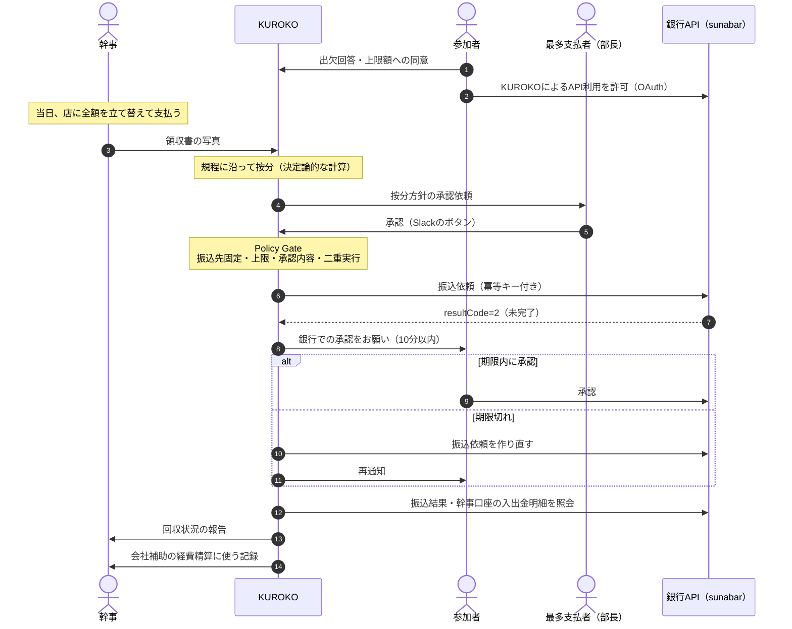

# KUROKO レビュー 03: 支払いの設計（B案: 幹事が立て替え、参加者が幹事に払う）

> **更新あり**: 案B-1に決定しました。Slackでの承認の体験、承認者とストーリーの前提（承認者は必ず1名で必ず承認する、当日欠席なし）、会社規程データは [04_Slack承認とストーリー](2026-09-13_KUROKO_review_04_story.md) の内容が優先します。

- 前回: [02_シナリオレビュー](2026-09-13_KUROKO_review_02_scenario.md)
- レビュー日: 2026-09-13（提出締切 2026-10-15 23:59 まで **残り約32日**）
- 決定事項: **お金の流れはB案**（幹事が店に立て替えて払い、参加者が幹事に払う）
- 本書は、02の支払いに関する記述（4.1〜4.5、6.3のカード情報、9〜12章のStripe関連）を置き換えます

---

## 目次

1. [結論](#1-結論)
2. [B案で変わること](#2-b案で変わること)
3. [Stripeや自前の集金を使わない理由](#3-stripeや自前の集金を使わない理由)
4. [sunabar（銀行APIサンドボックス）で分かっていること](#4-sunabar銀行apiサンドボックスで分かっていること)
5. [「エージェントが支払いを実行する」をどこまでやるか](#5-エージェントが支払いを実行するをどこまでやるか)
6. [更新版の支払いフロー](#6-更新版の支払いフロー)
7. [Policy Gate の追加・変更](#7-policy-gate-の追加変更)
8. [会社補助と幹事の経費精算](#8-会社補助と幹事の経費精算)
9. [B案で増える自律的な判断](#9-b案で増える自律的な判断)
10. [02からの差し替え一覧](#10-02からの差し替え一覧)
11. [今週中に潰すリスク](#11-今週中に潰すリスク)
12. [次に決めること](#12-次に決めること)
13. [参考情報](#13-参考情報)

---

## 1. 結論

- B案では、**KUROKOはお金を預からない**。参加者の口座から幹事の口座への**銀行振込を、銀行APIで指示する**
- ハッカソンでは、GMOあおぞらネット銀行の **sunabar**（無料の銀行APIサンドボックス）で実装する
- **Stripeは使わない**。Stripeは利用規約で、個人間の送金や割り勘の用途を禁止している
- 銀行は**振込ごとに口座の持ち主の承認**を求める。sunabarでも、振込依頼APIは依頼直後に「未完了」を返し、承認ページで承認して初めて振込が完了する（依頼から10分以内）
- そのため「エージェントが支払いを実行する」を**どこまでやるか**を決める必要がある（5章）。推奨は、**振込依頼の作成・送信から入金の確認までをKUROKOが担い、最後の承認だけは口座の持ち主に残す**案

---

## 2. B案で変わること

| 項目 | 02の推奨（A案） | 決定（B案） |
|---|---|---|
| 店への支払い | 幹事が法人カードで払う | **幹事が立て替えて払う** |
| 参加者の支払い先 | 会社 | **幹事** |
| 決済手段 | Stripe（カード） | **銀行振込API（sunabar）** |
| 事前同意 | カード登録＋上限額 | **銀行APIの利用許可（OAuth）＋上限額** |
| エージェントが実行すること | カードへの請求 | **振込依頼の作成・送信、承認状況の見守り、入金の確認** |
| 会社補助 | 最初から回収しない | **幹事が会社に経費精算する**（KUROKOが必要な記録を作る） |
| 課題のストーリー | 立て替えそのものをなくす | **立て替えたお金が確実に早く戻り、督促の気まずさがなくなる** |

---

## 3. Stripeや自前の集金を使わない理由

| 方式 | 問題 |
|---|---|
| KUROKOが参加者からお金を集めて、幹事に渡す（収納代行） | 個人の債権者のために代金を集める**割り勘アプリ型の収納代行は、資金移動業の登録が必要**と整理されている |
| Stripe（Connectを含む） | **利用規約で、個人間の送金や割り勘の用途を禁止**している |
| **参加者の口座から幹事の口座へ、銀行APIで振込を指示する**（KUROKOはお金を持たない） | お金を預からないため収納代行の問題は避けやすい。ただし、預金者の委託を受けて振込の指図を銀行に伝える業務は、**銀行法の電子決済等代行業（更新系）の登録**が必要 |

- ハッカソンではsunabarで実装し、説明文の「本番化に向けた論点」に「**電子決済等代行業の登録、または登録事業者・銀行との提携**」を書く
- 法的な判断は、専門家への確認が必要であることもあわせて明記する

---

## 4. sunabar（銀行APIサンドボックス）で分かっていること

| 項目 | 内容 |
|---|---|
| 利用条件 | GMOあおぞらネット銀行の口座（個人口座でよい）があれば、**審査なし・無料**で使える |
| 口座開設 | 個人口座は条件を満たせば**最短当日**に使える（1口座目で、マイナンバーカードの読み取りか自撮り動画で本人確認し、平日14時までに申し込んだ場合など） |
| 認可 | OAuth 2.0 / OpenID Connect |
| 振込依頼API | 振込先（銀行コード・支店コード・口座番号）を指定できる。**依頼直後は `resultCode = 2`（未完了）が返る** |
| 振込の承認 | sunabarサービスサイトの「お知らせ」に届くリンクから承認ページへ進み、取引パスワードを入力して承認する（サンドボックスでは任意の文字列でよい）。**依頼から10分以内**で、トークンは再発行できない |
| 冪等キー | 振込依頼・総合振込依頼で対応（Ver. 1.1.2 から）。リトライしても1回だけ実行される |
| 参照系API | 残高照会、入出金明細照会。**入金の確認**に使う |
| 口座の数 | 初期状態は個人・法人の各1口座。参加者役の口座を複数用意できるか（追加口座や、つかいわけ口座から振込できるか）は**要技術検証** |

---

## 5. 「エージェントが支払いを実行する」をどこまでやるか

### 案B-1（推奨）: 銀行での本人承認を残す

1. **出欠の回答時**: 参加者が上限額に同意し、KUROKOによる銀行APIの利用を許可する（OAuth）
2. **開催後**: 最も多く払う人が、按分方針をSlackで承認する
3. **KUROKO**: 全員分の振込依頼を作り、Policy Gateを通して銀行APIに送信する（冪等キー付き）
4. **KUROKO**: 各参加者に「銀行で承認してください（10分以内）」とDMする
5. **KUROKO**: 期限が切れたら、振込依頼を作り直して再通知する（2回まで）。それでも未完了なら幹事に報告する
6. **KUROKO**: 振込結果と幹事口座の入出金明細で入金を確認し、回収状況を更新する。全員が完了したら幹事に報告する

- **良い点**
  - 主要機能が実際のAPIで動く（モックではない）
  - 「お金を動かす最後の一押しは、口座の持ち主にしかできない」は実際の銀行の仕組みと一致し、ガバナンスの説得力が高い
  - 期限切れの再依頼や入金の確認など、**自律的に動く場面が増える**
- **弱い点**
  - 参加者に、銀行側での承認操作が1回残る
  - デモでは承認画面への切り替えが入る

### 案B-2: 事前同意だけで完全に自動実行する（模擬送金API）

- 自作の模擬送金API（残高、上限付きの委任、失敗の再現）に対して、按分方針の承認後にKUROKOが本人の操作なしで送金する
- **良い点**: 「承認したら自動で払われる」をそのまま見せられ、デモが滑らか
- **弱い点**: 決済部分がモックになり、審査基準③で弱い。現実の銀行では振込ごとに本人認証を求めるのが一般的なので、「本当に使えるのか」と問われたときに答えにくい

### 比較

| 観点 | B-1（本人承認を残す） | B-2（完全自動・模擬） |
|---|---|---|
| 実装の本物感（基準③） | 高い | 低い |
| ガバナンスの説得力（基準②） | 高い（3つの鍵） | 中（委任の設計次第） |
| デモの滑らかさ | 中 | 高い |
| 自律的に動く場面 | 多い（期限切れの再依頼、入金の確認） | 少ない |
| 実装量 | 中（OAuth、口座の準備） | 小〜中 |
| 事前準備 | 口座開設（最短当日） | なし |

### 案B-1の「3つの鍵」

| 鍵 | 誰が | いつ | 意味 |
|---|---|---|---|
| 1. 事前同意 | 参加者本人 | 出欠の回答時 | 上限額と、KUROKOが振込依頼を作ることへの許可 |
| 2. 按分方針の承認 | 最も多く払う人 | 開催後 | 誰がいくら払うかの確定 |
| 3. 銀行での本人承認 | 参加者本人 | 振込時 | お金を動かす最後の一押し |

> **ピッチでの言い方の例**: 「KUROKOは、振込の準備から入金の確認まで全部やります。ただし、お金を動かす最後の一押しだけは、口座の持ち主にしかできない設計にしています。」

---

## 6. 更新版の支払いフロー

---

## 7. Policy Gate の追加・変更

02の4.3の検査項目に、次を追加・変更します。

- [ ] **振込先は、幹事本人が登録した口座に固定する**。LLMの出力やSlackの発言からは変更できない（「振込先を次の口座に変えて」という攻撃が構造的に効かない）
- [ ] **口座番号はLLMに渡さない**。ツール関数が仮名IDから、秘密情報の保管場所で口座を解決する
- [ ] 振込元は、事前同意とOAuthでの許可を済ませた本人の口座だけ
- [ ] 金額は、承認済みの按分案（ハッシュ値が一致）に載っている本人の額で、事前同意の上限以下
- [ ] 同じ参加者への**完了済みの振込がないこと**を確認してから依頼する。期限切れで作り直す場合は、前の依頼が未完了であることを照会で確かめたうえで新しい冪等キーを使う
- [ ] 1イベントの振込依頼の合計が「立替額 − 会社補助 − 幹事本人の負担額」を超えない
- [ ] 幹事本人の負担分は振込を作らない
- [ ] アクセストークンは Secret Manager に保管し、スコープと有効期限は最小にする

---

## 8. 会社補助と幹事の経費精算

B案では幹事が店に全額を立て替えるため、回収は次の2つに分かれます。

| 回収元 | 金額 | 方法 |
|---|---|---|
| 会社 | 会社補助の額 | 幹事が経費精算する。KUROKOは必要な記録（日付、店名、参加者、人数、金額、領収書、按分表、承認履歴）を作る |
| 参加者 | 各自の負担額 | 銀行振込（本書） |

**02の8.2の計算例に当てはめた場合**（幹事は「一般」区分と仮定。数値はすべて仮の例）

| 項目 | 金額 |
|---|---:|
| 幹事の立替額（会計金額） | 97,300円 |
| 会社補助（経費精算で会社から受け取る） | 48,000円 |
| 参加者の負担額の合計 | 49,300円 |
| うち幹事本人の負担額 | 3,200円 |
| **振込で回収する額**（主役2名と幹事を除く13名） | **46,100円** |

内訳: 部長 7,500円 ＋ 課長 4,900円×2 ＋ 一般 3,200円×8 ＋ 入社1年未満 1,600円×2 ＝ 46,100円

※ 会社補助の有無と金額は、12章で確認させてください。

---

## 9. B案で増える自律的な判断

| 状況 | KUROKOの判断と行動 | レベル |
|---|---|---|
| 銀行での承認が10分以内にされなかった | 前の依頼が未完了であることを確かめ、振込依頼を作り直して再通知する（2回まで） | L0 |
| 再通知しても承認されない | 幹事に状況を報告し、どうするかを確認する | L2 |
| 入金額が請求額と違う | 本人に差額を伝え、追加の振込依頼を作るかを確認する | L1 |
| 参加者がOAuthでの許可をしていない | 口座情報を勝手に共有せず、幹事にどう扱うかを確認する | L2 |
| 全員の入金を確認した | 幹事に完了を報告し、経費精算に使う記録を渡す | L0 |

---

## 10. 02からの差し替え一覧

| 02の箇所 | 変更内容 |
|---|---|
| 1章「支払い」の行 | 「エージェントが支払いを実行」→「振込依頼の作成・送信と入金の確認まで（案B-1の場合）」 |
| 4.1 | 「二層の同意」→ 本書5章の「3つの鍵」 |
| 4.2 | A案の推奨 → B案に決定（本書） |
| 4.3 | 本書7章の項目を追加 |
| 4.4 | カードの拒否 → 承認の期限切れ、入金額の不一致（本書9章） |
| 4.5 | 3Dセキュア → 電子決済等代行業（本書3章） |
| 6.3 | 「カード情報」→「幹事の口座番号（LLMに渡さない）、参加者のアクセストークン（Secret Manager）」 |
| 9章 | Stripe → 銀行API（sunabar） |
| 10章 | 「事前同意とカード登録」→「事前同意とOAuthでの許可」、「支払いの実行」→「振込依頼の送信と入金の確認」 |
| 11章 | 2:25–2:45 を「振込依頼 → 1人が銀行で承認 → 入金を確認 → 別の1人は期限切れで自動的に再依頼」に変更 |
| 12章 | Stripeの疎通 → 口座開設とsunabarの疎通（本書11章） |

---

## 11. 今週中に潰すリスク

- [ ] **GMOあおぞらネット銀行の個人口座を開設し、sunabarを使えるようにする**（最短当日。平日14時までに申し込む）
- [ ] sunabarで「OAuth → 振込依頼 → 承認 → 入出金明細での確認」を一通り動かす
- [ ] 参加者役の口座を複数用意できるかを確認する（追加口座や、つかいわけ口座から振込できるか）。足りなければチームメンバーの口座も使う
- [ ] 承認前に期限が切れた振込依頼の状態の照会方法と、作り直すときの冪等キーの扱いを確認する
- [ ] 駅すぱあとのアクセスキーを申請する（02から継続）

---

## 12. 次に決めること

1. **案B-1（銀行での本人承認を残す）か、案B-2（完全自動・模擬送金）か** ← 次に決めたいこと
2. 会社補助の有無と金額
3. チームの人数、役割分担、締切までに使える時間
4. 承認の例外ルール（最多支払者が承認しない、または同額の人が複数いる場合）
5. 当日欠席の負担ルール

---

## 13. 参考情報

- Stripeの禁止業種: [Prohibited and Restricted Businesses](https://stripe.com/legal/restricted-businesses)、[FAQ](https://support.stripe.com/questions/prohibited-and-restricted-businesses-list-faqs)
- 割り勘アプリと資金移動業: [割り勘アプリに対する規制の導入（ZeLo）](https://zelojapan.com/en/lawsquare/7998)、[収納代行業に許認可制度はある？（マネーフォワード）](https://biz.moneyforward.com/establish/basic/71476/)
- 電子決済等代行業: [銀行法上の電子決済等代行業の定義（BUSINESS LAWYERS）](https://www.businesslawyers.jp/practices/876)、[銀行API連携と電子決済等代行業（LASSIC）](https://lassic.co.jp/media/column/dendai-bank-api/)
- sunabar: [sunabar はじめてガイド](https://gmo-aozora.com/sunabar/tutorial/01.html)、[振込依頼APIの結果コードが2（未完了）で返ってきます](https://help.gmo-aozora.com/faqs/6686541eefe214ffd6342ceb/)、[振込時の取引パスワード・メールトークン](https://help.gmo-aozora.com/faqs/6686541eefe214ffd6342cf9/)、[sunabar のアップデート（冪等キーなど）](https://gmo-aozora.hatenablog.com/entry/sunabar_update2020-2023)、[sunabar FAQ一覧](https://help.gmo-aozora.com/categories/6684ed44efe214ffd62ee83f/)
- 口座開設: [即日口座開設の申込ができる条件](https://help.gmo-aozora.com/faqs/6686541defe214ffd6342c57/)
